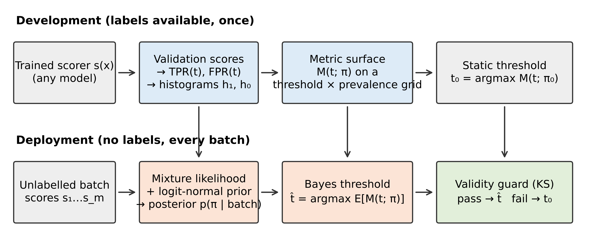
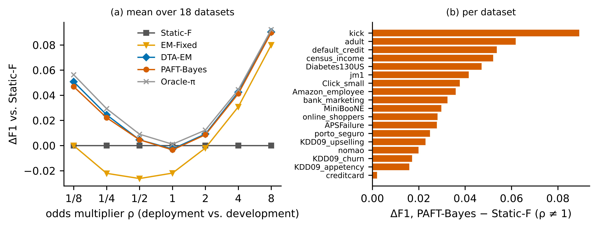
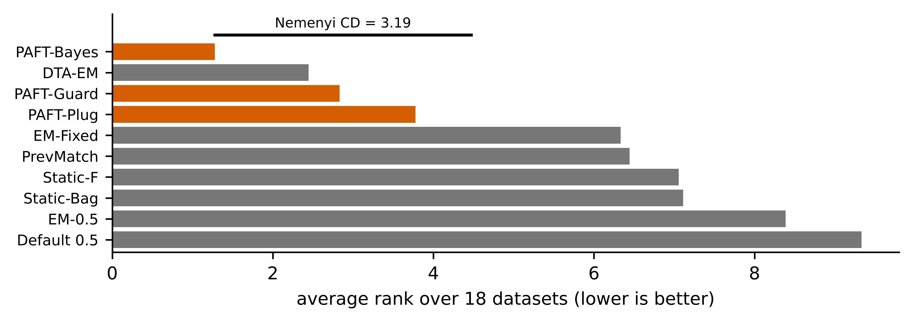
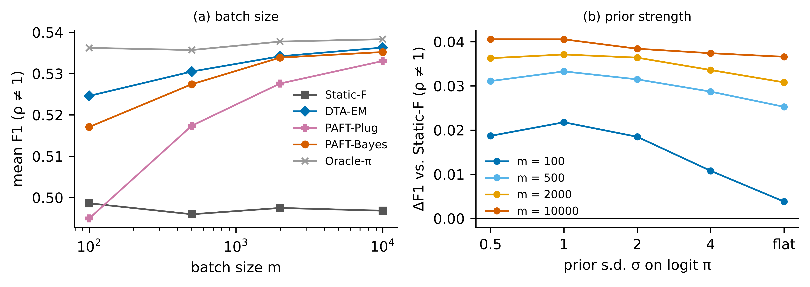
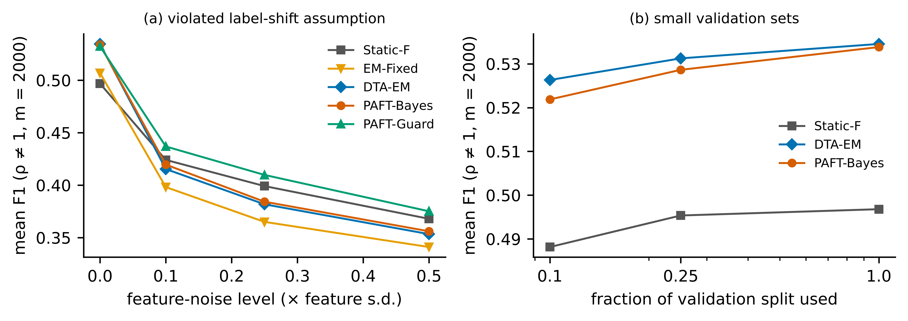
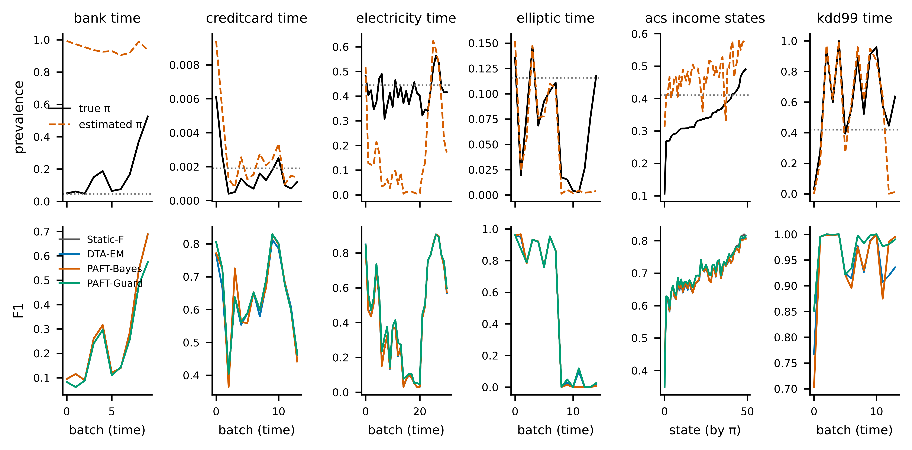

**Abstract**

Classifiers for imbalanced problems are deployed with a decision threshold tuned for the F-measure on validation data. That threshold is optimal only for the validation prevalence, yet prevalence drifts after deployment. We characterise the F~β~-optimal threshold under prior-probability (label) shift and propose PAFT, a model-agnostic decision layer that infers the deployment prevalence from unlabelled scores with a mixture likelihood and a weak prior, selects the threshold maximising the posterior-expected metric on a validation-derived surface, and applies a goodness-of-fit guard that reverts to the static threshold when the label-shift assumption is rejected. We compare it with seven baselines on 18 public tabular datasets (four base learners, 226,800 simulated deployment batches) and on six real temporal or cross-site shifts. Under controlled label shift PAFT improves mean F1 over the static threshold on all 18 datasets (+0.036, 95% CI +0.027 to +0.045; Holm-adjusted *p* < 0.001) and is statistically indistinguishable from the strongest existing rule, expected-F maximisation on EM-corrected posteriors (−0.001; *p* = 0.099), while also covering metrics which that rule does not. On the real shifts, label-free adaptation by any method gives no reliable gain and significantly lowers F1 on two suites because prevalence estimation breaks; the guard detects this and restores static performance. Prevalence-adaptive thresholding is thus effective when label shift holds and should be guarded otherwise. A small labelled audit sample used only to estimate prevalence helped on one real suite and harmed on another; when the concept has changed, labels are better spent on re-tuning the threshold.

**Keywords** Class imbalance · Decision threshold · F-measure · Label shift · Quantification · Dataset shift

# 1 Introduction

Rare-event classification is the normal case in applied machine learning: fraud, churn, intrusion, readmission and defect prediction all have a minority class of interest [1, 2, 3]. Because accuracy is uninformative under imbalance, such systems are evaluated with precision–recall metrics, most often the F-measure, and the score produced by the learner is converted into a decision by a threshold tuned on held-out data [4, 5, 6, 7]. A recent 45-task study confirms that threshold tuning is one of the most consistently useful interventions for imbalanced tabular problems [8].

A tuned threshold has a weakness that is easy to overlook. Unlike cost-based decisions, for which a fixed posterior threshold stays optimal, the F-measure is not decomposable over instances, and its optimal threshold depends on the class prevalence itself [4, 9]. Prevalence, however, is exactly what changes after deployment: fraud rates move with campaigns, positive rates in marketing follow the economy, and disease rates differ between sites [10, 11, 12]. A threshold that was F-optimal on validation data is therefore systematically wrong on the deployment stream, even if the classifier itself is unchanged.

The literature offers the ingredients of a remedy but not a tested recipe. Prior-shift adaptation re-weights posteriors with an estimated deployment prior [13, 14, 15, 16], and quantification estimates that prior from unlabelled data [17, 18, 19]. Yet correcting the posterior is not the same as correcting an F-optimal decision, and the closest deployment-oriented workflow sidesteps the F-measure by recommending expected cost instead [12]. Three questions remain open for practitioners who must report F-type metrics: how large the loss of a static threshold is, which label-free rule recovers it, and whether any of this survives real shifts, which are rarely pure label shifts.

This paper answers these questions with a formal characterisation, a method, and a deliberately two-sided evaluation. Our contributions are the following.

1. **Characterisation.** We express any confusion-matrix metric at deployment prevalence π as a closed-form function of π and the validation ROC curve, generalise the F1 optimality condition of Lipton et al. [4] to F~β~ under a shifted prior, and show that the common practice of applying a fixed, validation-tuned threshold to prior-corrected posteriors is biased in a predictable direction (Section 3).
2. **Method.** We propose PAFT (prevalence-adaptive F-measure thresholding), a decision layer that needs only validation scores: a mixture-likelihood posterior over the deployment prevalence, a Bayes threshold that maximises the posterior-expected metric, and a goodness-of-fit guard that falls back to the static threshold when the label-shift model does not fit the batch (Section 4). It is inductive (it outputs a threshold on the score), calibration-free, and applies to F~β~ and the Matthews correlation coefficient alike.
3. **Evidence under controlled shift.** On 18 datasets, four base learners and 226,800 batches, we quantify the loss of static thresholds and compare eight label-free rules with dataset-level paired tests. Adaptive rules recover most of the oracle gap; PAFT matches, but does not exceed, expected-F maximisation on EM-corrected posteriors (Section 6).
4. **Evidence under real shift, including negative results.** On six temporal or cross-site suites, no label-free rule helps reliably and several hurt. We separate failures of prevalence estimation from failures of the threshold map, show that the guard prevents the harm, and evaluate a label-assisted variant that spends a small audit sample on prevalence only, which helps on one suite and harms on another (Sections 6.6–6.7).

We state plainly what the paper does not claim: PAFT is not more accurate than the best existing transductive rule under label shift, and unguarded prevalence adaptation is not safe on real tabular drift. The value of the work lies in the characterisation, the guard, and an evaluation that separates the regime where prevalence adaptation works from the regime where it does not.

# 2 Related work

**Threshold selection for imbalanced data.** Moving the decision threshold is a long-standing alternative to resampling [1, 20]. Lipton et al. [4] showed that the F1-optimal threshold on calibrated probabilities equals half the optimal F1, so it varies with prevalence and classifier quality; Ye et al. [9] contrasted threshold tuning with decision-theoretic maximisation of expected F on a test set, and Jansche [21] optimised an expected F-measure during training. Zou et al. [5], GHOST [6] and Leevy et al. [7] tune thresholds on development data, and Dal Pozzolo et al. [22] correct thresholds for the prior change introduced by undersampling. All of these assume that deployment prevalence equals the development prevalence, or that the change is known.

**Prior-probability (label) shift.** When P(y) changes and P(x | y) does not [10, 23], posteriors can be corrected by re-weighting with the new prior, which Saerens et al. [13] estimate by expectation–maximisation (EM). Black-box shift estimation [14], regularised variants [24], the maximum-likelihood view with bias-corrected calibration [15, 25] and practical guides [16] refine the estimate, and Tasche [26] and Vaz et al. [27] study its consistency. These works evaluate prior estimation error, calibration and accuracy; the induced Bayes rule is optimal for decomposable losses, not for F-type metrics. Du Plessis and Sugiyama [28] estimate the class balance by distribution matching with the same limitation.

**Quantification.** Estimating prevalence in unlabelled samples is a task in its own right [17, 18, 19]. Adjusted counts [17], probabilistic variants [29], Hellinger-distance mixture matching [30] and the DyS family [31] are available in QuaPy [32]. Tasche [33] analyses exact fit of two-component mixtures. The quantification literature optimises prevalence error and usually stops before the decision.

**ROC analysis under changing class distributions.** Provost and Fawcett [34] used the ROC convex hull to choose operating points when class distributions and costs are imprecise, and Fawcett [35] and Flach and Kull [36] discuss how precision-type metrics depend on prevalence. The identity we use, that a confusion-matrix metric is a function of prevalence and a ROC point, is therefore classical; what has been missing is its use as an operational, label-free deployment rule with uncertainty handling and an empirical test.

**Deployment under prevalence shift.** Godau et al. [12] study 30 medical-imaging tasks, show that prevalence shift degrades calibration and tuned decision rules, and propose prevalence-aware re-calibration followed by the Bayes rule for expected cost; prevalences are assumed known or externally estimated, imbalance ratios do not exceed 10, and shifts are simulated. Alsulaimawi [37] adapts a Bayes threshold online from likelihood ratios for cost-sensitive decisions. Neither gives an F-optimal rule or tests it on real drift. Concept-drift research [38, 39, 40] and shift detection [41] address changes in P(y | x), usually with labels or by retraining.

**Gap.** Table 1 summarises the position of this work. No prior study, to our knowledge, combines an F-optimal decision rule under estimated prevalence, an explicit validity check of the label-shift assumption, strong label-free baselines including decision-theoretic F maximisation, extreme imbalance on tabular data, and real non-simulated shifts. We make no claim that the ingredients are new.

| Work | Decision mechanism | Deployment prevalence | F-optimal under shift | Validity check | Shift in evaluation |
|---|---:|---:|---:|---:|---:|
| Lipton et al. [4] | F1-optimal threshold | No | – | – | – |
| Saerens et al. [13]; Alexandari et al. [15] | Posterior correction | Estimated (EM) | No (accuracy, calibration) | No | Simulated |
| Forman [17]; Esuli et al. [19] | Prevalence estimation | Estimated | No decision rule | No | Simulated, some real |
| Ye et al. [9] | Expected-F maximisation | No | Yes | – | – |
| Esposito et al. [6] | Static threshold tuning | No | No (kappa) | – | – |
| Godau et al. [12] | Re-calibration + Bayes rule | Assumed known / external | No (expected cost) | No | Simulated (images) |
| Alsulaimawi [37] | Online Bayes threshold | Estimated online | No (cost-sensitive) | No | Simulated |
| This work | Threshold from ROC surface | Estimated, with posterior | Yes (F~β~, MCC) | Yes | Simulated and six real suites |

: **Table 1** Position of this work relative to the closest prior work

# 3 Problem formulation and analysis

## 3.1 Setting

Let $s:\mathcal{X}\to\mathbb{R}$ be a fixed scoring function produced by any learner, with larger values indicating the positive class $y=1$. Development data follow a distribution $P$ with prevalence $\pi_0=P(y=1)$; a deployment batch $\{x_i\}_{i=1}^{m}$ is drawn from $Q$ with unknown prevalence $\pi=Q(y=1)$ and unobserved labels. A decision rule predicts $\hat y_i=\mathbb{1}[s(x_i)\ge t]$. The label-shift assumption states that the class-conditional distributions of the score are unchanged,

$$Q(s\mid y)=P(s\mid y),\qquad y\in\{0,1\}. \qquad (1)$$

Assumption (1) is weaker than invariance of $P(x\mid y)$, because it concerns only the one-dimensional score. Define the validation ROC functions $G_1(t)=P(s\ge t\mid y=1)$ (true-positive rate) and $G_0(t)=P(s\ge t\mid y=0)$ (false-positive rate).

## 3.2 Metrics as functions of prevalence and a ROC point

Under (1) the expected confusion matrix of threshold $t$ on the deployment distribution has entries $\pi G_1$, $(1-\pi)G_0$, $\pi(1-G_1)$ and $(1-\pi)(1-G_0)$. Any metric $M$ that is a function of the normalised confusion matrix is therefore a function $M(t;\pi)$ of the threshold and the prevalence alone. For the F-measure with weight $\beta$,

$$F_\beta(t;\pi)=\frac{(1+\beta^2)\,\pi\,G_1(t)}{\beta^2\pi+\pi\,G_1(t)+(1-\pi)\,G_0(t)}. \qquad (2)$$

The static, validation-tuned threshold is $t_0=\arg\max_t F_\beta(t;\pi_0)$, and the best threshold for the deployment distribution is $t^\star(\pi)=\arg\max_t F_\beta(t;\pi)$. The *regret* of the static rule is $F_\beta(t^\star(\pi);\pi)-F_\beta(t_0;\pi)\ge 0$. Figure 1 illustrates (2) for one of the benchmark datasets.

{width=6.3in}

## 3.3 Optimality condition under a shifted prior

**Proposition 1.** *Assume $G_1$ and $G_0$ are differentiable with densities $g_1,g_0$, and let $t^\star$ be an interior maximiser of (2) with value $F^\star_\beta(\pi)$. Then the deployment posterior at the threshold satisfies*

$$\eta_\pi(t^\star)\;=\;\frac{\pi g_1(t^\star)}{\pi g_1(t^\star)+(1-\pi)g_0(t^\star)}\;=\;\frac{F^\star_\beta(\pi)}{1+\beta^2}, \qquad (3)$$

*equivalently, in terms of the prevalence-free likelihood ratio $\lambda(t)=g_1(t)/g_0(t)$,*

$$\lambda(t^\star)=\frac{1-\pi}{\pi}\cdot\frac{F^\star_\beta(\pi)}{1+\beta^2-F^\star_\beta(\pi)}. \qquad (4)$$

*Proof.* Write $F_\beta=N/D$ with $N=(1+\beta^2)\pi G_1$ and $D=\beta^2\pi+\pi G_1+(1-\pi)G_0$. Since $G_y'=-g_y$, the first-order condition $N'D=ND'$ gives $(1+\beta^2)\pi g_1 D=N\,(\pi g_1+(1-\pi)g_0)$. Dividing by $D\,(\pi g_1+(1-\pi)g_0)$ yields (3); solving (3) for $g_1/g_0$ yields (4). ∎

For $\beta=1$ and $\pi=\pi_0$, (3) is the result of Lipton et al. [4]. The shifted form has two practical consequences.

**Corollary 1 (fixed posterior thresholds are biased).** For any fixed $t$ with $G_1(t)>0$, dividing numerator and denominator of (2) by $\pi$ shows that $F_\beta(t;\pi)$ is non-decreasing in $\pi$; hence so is $F^\star_\beta(\pi)$. By (3), the optimal threshold on the *prior-corrected* posterior rises with prevalence. A rule that corrects the posterior for the new prior but keeps the validation-tuned posterior threshold $F^\star_\beta(\pi_0)/(1+\beta^2)$ is therefore too permissive when prevalence has fallen and too strict when it has risen.

**Corollary 2 (direction on the raw score).** In (4) the factor $(1-\pi)/\pi$ decreases in $\pi$ while the second factor increases. When the first effect dominates, which is the usual case for classifiers far from perfect separation, the optimal threshold on the *uncorrected* score falls as prevalence rises: a larger positive pool raises precision at every threshold, so recall can be bought more cheaply. Section 6.9 reports how often this direction is observed.

**Remark (sensitivity to the prevalence estimate).** If $F_\beta(\cdot;\pi)$ is twice differentiable with a unique interior maximiser, then a plug-in threshold $t^\star(\hat\pi)$ has regret of second order in $\hat\pi-\pi$, by the usual argument for perturbed maximisers. Small quantification errors are thus cheap, but the regret grows quickly when $\hat\pi$ is wrong by a large factor, which is what happens for rare classes in small batches and, as Section 6.6 shows, when (1) is violated. This motivates treating $\pi$ as uncertain rather than plugging in a point estimate.

# 4 Proposed method: PAFT

PAFT has a development stage, executed once on the labelled validation split, and a deployment stage, executed on every unlabelled batch (Figure 2). It never modifies or retrains the scorer.

{width=6.3in}

## 4.1 Development stage

From the validation scores we compute (i) the empirical ROC functions $\hat G_1,\hat G_0$ on a set of $T$ candidate thresholds, consisting of the validation scores of both classes, each class thinned to at most 1,024 quantiles so that the minority-class tail is resolved; (ii) class-conditional histograms $\hat h_1,\hat h_0$ of the score on $B$ bins whose edges are class-balanced quantiles, with $B=\min(32,\max(8,\lfloor n_1/10\rfloor))$ for $n_1$ validation positives and Laplace smoothing of 0.5 per bin; and (iii) the metric surface $M(t_j;\pi_g)$ on the $T$ thresholds and a grid of $G=161$ prevalences that is uniform on the logit scale and centred on $\pi_0$ (±9 logits). The static threshold $t_0$ is the maximiser of the row $\pi_g=\pi_0$, which coincides with the usual empirical F-maximising threshold on the validation split. More generally, maximising a row of the surface is equivalent to tuning the threshold on the validation split after re-weighting positives by $\pi/\pi_0$ and negatives by $(1-\pi)/(1-\pi_0)$; the surface is simply the pre-computed form of this importance-weighted re-tuning for all prevalences at once.

## 4.2 Posterior over the deployment prevalence

Let $n_b$ be the number of batch scores in bin $b$. Under (1) the scores follow a two-component mixture with known components and unknown weight, with log-likelihood

$$\ell(\pi)=\sum_{b=1}^{B} n_b\,\log\!\big(\pi\,\hat h_{1b}+(1-\pi)\,\hat h_{0b}\big). \qquad (5)$$

Maximising (5) is the EM estimator of Saerens et al. [13] applied to histogram-calibrated scores, and is a likelihood counterpart of Hellinger-distance mixture matching [30, 31]; we do not claim it as a new quantifier. Because (5) is concave in the scalar $\pi$, we evaluate it on the grid and combine it with a weakly informative prior on the log-odds, $\operatorname{logit}\pi\sim\mathcal{N}(\operatorname{logit}\pi_0,\sigma^2)$:

$$w_g\;\propto\;\exp\!\Big\{\ell(\pi_g)-\tfrac{1}{2\sigma^2}\big(\operatorname{logit}\pi_g-\operatorname{logit}\pi_0\big)^2\Big\},\qquad \sum_g w_g=1. \qquad (6)$$

We use $\sigma=2$ throughout, which places 95% prior mass on odds changes of up to a factor of about 50 in either direction; this value was fixed before any deployment-batch result was inspected, and Section 6.3 reports its sensitivity.

## 4.3 Bayes threshold

Instead of plugging a point estimate into $t^\star(\cdot)$, PAFT chooses the threshold with the highest posterior-expected metric,

$$\hat t=\arg\max_{j}\;\sum_{g} w_g\,M(t_j;\pi_g). \qquad (7)$$

We call the plug-in rule $t^\star(\hat\pi_{\mathrm{MLE}})$ *PAFT-Plug* and rule (7) *PAFT-Bayes*. Rule (7) hedges against quantification error: when the batch is small or the classes are poorly separated, the posterior is wide and the chosen threshold stays close to thresholds that perform acceptably across plausible prevalences.

## 4.4 Validity guard

Adaptation is justified only if (1) holds. We test it on each batch by comparing the empirical distribution function $\hat F_m$ of the batch scores with the fitted mixture $\hat\pi\hat F_1+(1-\hat\pi)\hat F_0$, where $\hat F_y$ are the validation class-conditional distribution functions and $\hat\pi$ maximises (5):

$$D=\sup_s\big|\hat F_m(s)-\hat\pi\hat F_1(s)-(1-\hat\pi)\hat F_0(s)\big|. \qquad (8)$$

The mixture is itself estimated from $n_1$ and $n_0$ validation scores, so we refer $D$ to the two-sample Kolmogorov distribution with effective size $m\,n_\mathrm{eff}/(m+n_\mathrm{eff})$, $n_\mathrm{eff}=\big(\hat\pi^2/n_1+(1-\hat\pi)^2/n_0\big)^{-1}$, using the finite-sample correction of Stephens [42]. *PAFT-Guard* returns $\hat t$ if the *p*-value is at least $\alpha_g=0.01$ and the static threshold $t_0$ otherwise. The reference distribution is approximate (the weight is fitted and bootstrap resampling of small positive pools is ignored), so $\alpha_g$ is a tuning level rather than an exact size; Section 6.4 reports the observed firing rates.

## 4.5 Label-assisted variant

The real-shift results of Section 6.6 led us to add one variant after the main experiments had been analysed; it is reported as such. If $n_L$ instances of the batch can be labelled, of which $k$ are positive, their count is binomial in $\pi$ regardless of any change in $P(x\mid y)$. *PAFT-L* replaces (5) by $k\log\pi+(n_L-k)\log(1-\pi)$ in (6); the guarded version adds (5) for the unlabelled remainder only when the guard passes. Labels are thus spent on a single scalar, while the threshold map still comes from validation data.

## 4.6 Complexity

The development stage is dominated by sorting the validation scores. A deployment batch costs $O(m\log B)$ for binning, $O(GB)$ for (5)–(6), $O(GT)$ for (7) and $O(m\log m)$ for the guard; the stored state is the $G\times T$ surface. Measured costs are given in Section 6.8.

# 5 Experimental setup

## 5.1 Research questions

RQ1: How much F1 does a static threshold lose under prevalence shift, and how much do label-free rules recover? (Experiments 1–2.) RQ2: Which components of PAFT matter? (Experiment 3.) RQ3: How robust are the rules to small batches, small validation sets and violations of label shift? (Experiment 4.) RQ4: Do the conclusions transfer to other metrics, other base learners and real shifts? (Experiment 5.) RQ5: What does adaptation cost computationally, and where does it fail? (Experiments 6–8.) All experiments, the split, the seeds, the shift grid and the PAFT hyper-parameters were fixed before deployment-batch results were examined; the label-assisted variant (Experiment 9) is the single post-hoc addition.

## 5.2 Controlled-shift benchmark

**Datasets.** We use every dataset we identified on OpenML [43] that met criteria fixed in advance: a binary target (or a standard binarisation), at least 10,000 instances, at least 400 minority instances and a minority prevalence of at most 30%. We screened 30 widely used OpenML datasets against these criteria (Supplementary Table S17); one further eligible candidate could not be downloaded and is therefore missing. This gives 18 datasets from fraud, churn, marketing, credit, industrial failure, physics and census domains (Table 2), with prevalences from 0.17% to 28.6%; the minority class is always the positive class. Among them are the credit-card fraud data of Dal Pozzolo et al. [22], bank marketing [44] and 30-day readmission [45].

| Dataset | Instances | Features | Prevalence (%) | Duplicate rows | AUC | AP |
|---|---:|---:|---:|---:|---:|---:|
| creditcard | 284,807 | 29 | 0.17 | 9,144 | 0.926 | 0.778 |
| KDD09_appetency | 50,000 | 230 | 1.78 | 0 | 0.800 | 0.090 |
| APSFailure | 76,000 | 170 | 1.81 | 0 | 0.990 | 0.880 |
| porto_seguro | 595,212 | 57 | 3.64 | 0 | 0.633 | 0.064 |
| Amazon_employee | 32,769 | 9 | 5.79 | 0 | 0.727 | 0.300 |
| census_income | 199,523 | 41 | 6.21 | 3,230 | 0.952 | 0.674 |
| KDD09_churn | 50,000 | 230 | 7.34 | 0 | 0.690 | 0.140 |
| KDD09_upselling | 50,000 | 230 | 7.36 | 0 | 0.860 | 0.541 |
| Diabetes130US | 101,766 | 49 | 11.16 | 0 | 0.672 | 0.228 |
| bank_marketing | 45,211 | 16 | 11.70 | 0 | 0.934 | 0.623 |
| kick | 72,983 | 32 | 12.30 | 0 | 0.777 | 0.491 |
| online_shoppers | 12,330 | 17 | 15.47 | 125 | 0.928 | 0.735 |
| Click_small | 39,948 | 9 | 16.84 | 194 | 0.698 | 0.330 |
| jm1 | 10,885 | 21 | 19.35 | 2,061 | 0.721 | 0.407 |
| default_credit | 30,000 | 23 | 22.12 | 56 | 0.779 | 0.553 |
| adult | 48,842 | 14 | 23.93 | 57 | 0.926 | 0.823 |
| MiniBooNE | 130,064 | 50 | 28.06 | 467 | 0.984 | 0.956 |
| nomao | 34,465 | 118 | 28.56 | 2,405 | 0.995 | 0.988 |

: **Table 2** Datasets of the controlled-shift benchmark, ordered by minority prevalence. AUC and average precision (AP) are test-pool means over five seeds for LightGBM

*Note.* Duplicate rows are rows whose feature vector occurs more than once; the group-aware split keeps them in one partition.

**Splits and leakage control.** Each dataset is split into training (50%), validation (20%) and test pool (30%) by stratified group ten-fold assignment, repeated for seeds 0–4. Rows with identical feature vectors form one group, so exact duplicates (up to 9,144 rows in one dataset, Table 2) cannot straddle splits; the audit confirms zero cross-split duplicates in all 360 fits. Encoders, imputation and scaling statistics are fitted on the training split only. Early stopping uses a 10% slice of the training split, so the validation split is used only by the decision layer and is the same for all rules.

**Base learners.** LightGBM [46] is the main learner; XGBoost [47], logistic regression and a two-hidden-layer perceptron (256 and 128 units) test model-agnosticism, in line with evidence that boosted trees remain strong on tabular data [48, 49]. Hyper-parameters are fixed across datasets (Supplementary Section S1); no rule benefits from tuning that another is denied, since all rules consume the same scores.

**Shift protocol.** For each fit we draw deployment batches from the test pool by the artificial-prevalence protocol used in quantification research [17, 19]: the odds of the positive class are multiplied by ρ ∈ {1/8, 1/4, 1/2, 1, 2, 4, 8}, the number of positives is binomial in the batch size *m* ∈ {500, 2,000, 10,000} (conditioned on at least one instance of each class), and instances are drawn with replacement within each class. With 30 repetitions per cell this gives 630 batches per fit and 226,800 batches in the main experiment. Label shift holds by construction.

## 5.3 Real-shift suites

Six suites use naturally ordered or naturally partitioned data; nothing from a deployment batch is used for fitting (Table 3). *Bank-time*: the chronologically ordered bank telemarketing data [44] without the leaking call-duration feature; the first half is development data, followed by batches of 2,000 calls. *Creditcard-time*: the fraud transactions in time order, first half for development, then batches of 10,000. *Electricity-time*: the Elec2 price-direction stream [40], first 30% for development, then three-week batches. *Elliptic-time*: labelled Bitcoin transactions [50] with the customary split at time step 34 and one batch per later step. *ACS-income-states*: the ACSIncome task [51] on the 2018 one-year survey, developed on California and deployed on each of the other 49 states and Puerto Rico. *KDD99-time*: the KDD Cup 1999 network-intrusion data (10% subset, 494,021 connections in capture order, as distributed with scikit-learn), with any attack as the positive class; the first 15% of connections are development data, followed by batches of 10,000 connections, of which those containing a single class are skipped. This suite was added after the first internal review round, with its split fixed before any result was computed, because intrusion detection is a domain in which the class plausibly causes the features. Development data are split 5:2 into training and validation as above.

| Suite | Batches | m | π0 (dev.) | π min | π max | AUC (deploy.) | MAE of π̂ | Guard fire rate |
|---|---:|---:|---:|---:|---:|---:|---:|---:|
| acs_income_states | 50 | 3,064–135,924 | 0.4106 | 0.1061 | 0.4904 | 0.874 | 0.1315 | 0.95 |
| bank_time | 10 | 2,000–2,000 | 0.0467 | 0.0470 | 0.5245 | 0.498 | 0.7762 | 1.00 |
| creditcard_time | 14 | 10,000–10,000 | 0.0019 | 0.0004 | 0.0061 | 0.910 | 0.0010 | 1.00 |
| electricity_time | 31 | 1,008–1,008 | 0.4445 | 0.3075 | 0.5635 | 0.809 | 0.2551 | 1.00 |
| elliptic_time | 15 | 471–2,154 | 0.1158 | 0.0028 | 0.1468 | 0.898 | 0.0216 | 1.00 |
| kdd99_time | 14 | 10,000–10,000 | 0.4189 | 0.0319 | 0.9985 | 0.997 | 0.1400 | 1.00 |

: **Table 3** Real-shift suites (LightGBM, means over five seeds)

*Note.* AUC is the mean per-batch area under the ROC curve on deployment data; MAE of π̂ is the mean absolute error of the PAFT posterior-mean prevalence.

## 5.4 Compared rules

All rules receive the same validation scores and the same unlabelled batch.
*Default 0.5*: threshold 0.5 on the isotonic-calibrated probability [52, 53].
*Static-F*: the validation-tuned threshold $t_0$, the standard practice.
*Static-Bag*: the median of $t_0$ over 50 stratified bootstrap resamples of the validation split, a variance-reduced static rule in the spirit of GHOST [6] (it differs from GHOST, which optimises Cohen's kappa on training subsets).
*EM-0.5*: EM prior correction [13] of the calibrated posterior followed by the 0.5 rule, i.e. the Bayes rule for accuracy and the decision rule of prevalence-aware workflows [12].
*EM-Fixed*: the EM-corrected posterior with the static threshold mapped to posterior space.
*PrevMatch*: predict as positive the top $\hat\pi m$ scores, with $\hat\pi$ from adjusted classify-and-count [17].
*DTA-EM*: the decision-theoretic approach [9] applied to EM-corrected posteriors $q_i$: predict the top $k$ instances, with $k$ maximising the plug-in expected F~β~, $(1+\beta^2)\sum_{i\le k}q_{(i)}/(\beta^2\sum_i q_i+k)$. This is the strongest label-free competitor we are aware of; it is transductive (it ranks the whole batch) and specific to F~β~.
*PAFT-Plug, PAFT-Bayes, PAFT-Guard*: Section 4.
Two oracles bound what is achievable: *Oracle-π* applies $t^\star(\pi)$ with the true batch prevalence, and *Oracle-threshold* applies the best threshold for the labelled batch. Baselines use isotonic calibration; a Platt-type alternative is examined in Section 6.4 and changes no conclusion.

## 5.5 Metrics and statistical analysis

The primary metric is F1 on each batch; F~0.5~, F~2~ and the Matthews correlation coefficient (MCC) [54] test generality, and regret is measured against Oracle-threshold. Batch values are averaged over repetitions, batch sizes, shift levels and seeds to one value per dataset, so the unit of analysis is the dataset (n = 18) in the controlled benchmark and the deployment batch (averaged over seeds) in each real suite. Consecutive batches of a temporal suite are not independent, so the *p*-values for real suites are descriptive and we rely mainly on the direction and size of the effects there. We use two-sided Wilcoxon signed-rank tests [55] with Holm correction within each family of comparisons, as recommended for comparisons over multiple datasets [56], report the mean paired difference with a 10,000-resample percentile bootstrap 95% confidence interval [57] and the matched-pairs rank-biserial correlation as effect size [58], and add a Friedman test [59] with average ranks and the Nemenyi critical difference [56]. No seed or configuration was selected after seeing results; the standard deviation over seeds is reported in Supplementary Table S3.

# 6 Results

## 6.1 Static thresholds lose F1 under prevalence shift, and adaptive rules recover most of it (RQ1)

Table 4 and Figure 3 give the main result for LightGBM. Averaged over the six shifted levels, Static-F reaches a mean F1 of 0.496, against 0.537 for Oracle-π and 0.565 for Oracle-threshold. The loss grows with the size of the shift in either direction and is largest when prevalence rises eightfold in odds (0.674 against 0.766).

{width=6.3in}

PAFT-Bayes attains 0.532, closing 88% of the gap between Static-F and Oracle-π. It improves on Static-F on all 18 datasets, with a mean difference of +0.036 (95% CI +0.027 to +0.045; Holm-adjusted *p* < 0.001; rank-biserial 1.00; Table 5). The gain is stable across seeds (mean +0.036, standard deviation 0.0017 over the five seeds). It also exceeds EM-Fixed by +0.025 and PrevMatch by +0.023 on every dataset. As Corollary 1 predicts, EM-Fixed is close to PAFT when prevalence rises but falls to or below the level of Static-F when prevalence falls (Table 4, ρ < 1), where its fixed posterior threshold is too permissive.

**PAFT does not outperform DTA-EM.** The decision-theoretic rule on EM-corrected posteriors reaches 0.533. PAFT-Bayes is better on 14 of 18 datasets (median difference +0.001) and has the best average rank (1.28 against 2.44; Figure 4), but its mean is 0.001 lower because of two datasets with very few validation positives (creditcard and APSFailure, Section 6.9); the difference is not significant (*p* = 0.099), and the difference in average rank is below the Nemenyi critical difference of 3.19. The two rules should be regarded as equivalent in F1 under label shift. A Friedman test rejects equality of the ten rules (χ² = 131.5, *p* < 0.001).

{width=6.3in}

**Cost when nothing has shifted.** At ρ = 1 every adaptive rule pays a small price for estimating a prevalence that has not changed: PAFT-Bayes is 0.003 below Static-F (95% CI −0.006 to −0.002; Holm-adjusted *p* = 0.002), and DTA-EM is at the same level (0.525 against 0.524).

| Rule | ρ=1/8 | ρ=1/4 | ρ=1/2 | ρ=1 | ρ=2 | ρ=4 | ρ=8 | Shifted | All | Regret |
|---|---:|---:|---:|---:|---:|---:|---:|---:|---:|---:|
| Default 0.5 | 0.293 | 0.354 | 0.405 | 0.435 | 0.454 | 0.463 | 0.470 | 0.406 | 0.410 | 0.159 |
| Static-F | 0.268 | 0.354 | 0.446 | 0.528 | 0.594 | 0.642 | 0.674 | 0.496 | 0.501 | 0.069 |
| Static-Bag | 0.270 | 0.356 | 0.448 | 0.528 | 0.594 | 0.641 | 0.672 | 0.497 | 0.501 | 0.069 |
| EM-0.5 | 0.236 | 0.284 | 0.356 | 0.432 | 0.513 | 0.601 | 0.706 | 0.449 | 0.447 | 0.116 |
| EM-Fixed | 0.268 | 0.332 | 0.420 | 0.506 | 0.592 | 0.673 | 0.754 | 0.507 | 0.506 | 0.059 |
| PrevMatch | 0.280 | 0.353 | 0.433 | 0.507 | 0.585 | 0.664 | 0.740 | 0.509 | 0.509 | 0.056 |
| DTA-EM | 0.319 | 0.379 | 0.451 | 0.525 | 0.603 | 0.685 | 0.764 | 0.533 | 0.532 | 0.032 |
| PAFT-Plug | 0.298 | 0.364 | 0.444 | 0.520 | 0.601 | 0.683 | 0.764 | 0.526 | 0.525 | 0.040 |
| PAFT-Bayes | 0.315 | 0.376 | 0.451 | 0.524 | 0.603 | 0.683 | 0.764 | 0.532 | 0.531 | 0.033 |
| PAFT-Guard | 0.315 | 0.376 | 0.451 | 0.525 | 0.603 | 0.682 | 0.759 | 0.531 | 0.530 | 0.035 |
| Oracle-π | 0.325 | 0.383 | 0.455 | 0.529 | 0.607 | 0.687 | 0.766 | 0.537 | 0.536 | 0.028 |
| Oracle-threshold | 0.381 | 0.428 | 0.487 | 0.552 | 0.623 | 0.698 | 0.775 | 0.565 | 0.563 | 0.000 |

: **Table 4** Mean F1 by odds multiplier ρ (LightGBM; mean over 18 datasets, five seeds, three batch sizes and 30 batches per cell)

*Note.* Shifted = mean over ρ ≠ 1. Regret = mean difference to Oracle-threshold over ρ ≠ 1. Oracle rows use deployment labels and are bounds, not competitors.

| PAFT-Bayes versus | Mean ΔF1 | 95% CI | W/L | Rank-biserial | p | p (Holm) |
|---|---:|---:|---:|---:|---:|---:|
| Default 0.5 | +0.1257 | +0.083 to +0.172 | 18/0 | 1.00 | < 0.001 | < 0.001 |
| Static-F | +0.0355 | +0.027 to +0.045 | 18/0 | 1.00 | < 0.001 | < 0.001 |
| Static-Bag | +0.0352 | +0.027 to +0.045 | 18/0 | 1.00 | < 0.001 | < 0.001 |
| EM-0.5 | +0.0826 | +0.057 to +0.109 | 18/0 | 1.00 | < 0.001 | < 0.001 |
| EM-Fixed | +0.0255 | +0.018 to +0.034 | 18/0 | 1.00 | < 0.001 | < 0.001 |
| PrevMatch | +0.0229 | +0.017 to +0.029 | 18/0 | 1.00 | < 0.001 | < 0.001 |
| DTA-EM | −0.0014 | −0.007 to +0.002 | 14/4 | 0.45 | 0.099 | 0.099 |
| PAFT-Plug | +0.0065 | +0.004 to +0.010 | 18/0 | 1.00 | < 0.001 | < 0.001 |
| PAFT-Guard | +0.0013 | +0.000 to +0.002 | 17/1 | 0.98 | < 0.001 | < 0.001 |

: **Table 5** Paired comparison of PAFT-Bayes with each other rule under shift (ρ ≠ 1); unit of analysis: dataset (n = 18)

*Note.* Two-sided Wilcoxon signed-rank test; Holm correction over the nine comparisons; bootstrap percentile confidence interval of the mean difference; W/L = datasets won/lost by PAFT-Bayes.

## 6.2 Other base learners and metrics (RQ4)

The pattern is the same for all four learners (Supplementary Table S1): the gain of PAFT-Bayes over Static-F is +0.035 for XGBoost, +0.034 for logistic regression and +0.034 for the perceptron (all Holm-adjusted *p* < 0.001), and in each case PAFT-Bayes wins on most datasets against DTA-EM while having a slightly lower mean. Table 6 reports other metrics at *m* = 2,000. PAFT-Bayes improves on Static-F for F~0.5~ (+0.026), F~2~ (+0.040) and MCC (+0.014; all Holm-adjusted *p* < 0.01). For MCC the decision-theoretic formula does not apply, so PAFT is the only adaptive rule in the comparison that addresses it directly. For F~0.5~ DTA-EM has a higher mean than PAFT-Bayes (0.553 against 0.545), not significantly (*p* = 0.90).

| Rule | F0.5 | F2 | MCC |
|---|---:|---:|---:|
| Default 0.5 | 0.460 | 0.386 | 0.393 |
| Static-F | 0.519 | 0.564 | 0.438 |
| Static-Bag | 0.519 | 0.563 | 0.438 |
| EM-0.5 | 0.499 | 0.425 | 0.407 |
| EM-Fixed | 0.510 | 0.584 | 0.413 |
| PrevMatch | 0.515 | 0.508 | 0.431 |
| DTA-EM | 0.553 | 0.603 | – |
| PAFT-Plug | 0.543 | 0.594 | 0.448 |
| PAFT-Bayes | 0.545 | 0.603 | 0.453 |
| PAFT-Guard | 0.550 | 0.604 | 0.451 |
| Oracle-π | 0.550 | 0.608 | 0.454 |
| Oracle-threshold | 0.588 | 0.630 | 0.488 |

: **Table 6** Other target metrics under shift (LightGBM, m = 2,000, ρ ≠ 1). Each rule optimises the metric of the column

*Note.* DTA-EM is defined for F-measures only.

## 6.3 Ablation (RQ2)

Table 7 removes or replaces each component. (i) *Posterior versus point estimate.* The Bayes threshold improves on the plug-in rule with the same likelihood on all 18 datasets (+0.010, Holm-adjusted *p* < 0.001); the benefit is concentrated in small batches (+0.022 at *m* = 100 against +0.002 at *m* = 10,000), where a point estimate of a rare prevalence is unreliable. With *m* = 100 the plug-in rule is slightly worse than Static-F. (ii) *Prior width.* σ between 0.5 and 2 gives nearly identical results; wider or flat priors lose up to 0.007 (Figure 5). A tighter prior (σ = 1) is marginally better than our pre-specified σ = 2 (+0.002, Holm-adjusted *p* = 0.064); we keep σ = 2 as specified. (iii) *Quantifier.* With the plug-in rule, the choice among mixture maximum likelihood, adjusted counts, probabilistic adjusted counts and EM matters little, and all are clearly better than Hellinger-distance matching in small batches; handling uncertainty matters more than the particular estimator. (iv) *Decision rule.* Applying the decision-theoretic top-*k* rule to PAFT's own histogram posterior gives −0.002 relative to (7) (*p* = 0.043), so the equivalence with DTA-EM is not an artefact of the calibrator. (v) *Guard.* Under pure label shift the guard should be inactive; it costs 0.001 on average because it fires on some batches (Section 6.4).

{width=6.3in}

| Variant | m=100 | m=500 | m=2,000 | m=10,000 | No shift (ρ=1) |
|---|---:|---:|---:|---:|---:|
| Static-F | 0.499 | 0.496 | 0.497 | 0.497 | 0.526 |
| Plug-in, mixture MLE (PAFT-Plug) | 0.495 | 0.517 | 0.528 | 0.533 | 0.512 |
| Plug-in, ACC quantifier | 0.493 | 0.516 | 0.528 | 0.533 | 0.512 |
| Plug-in, PACC quantifier | 0.501 | 0.520 | 0.530 | 0.534 | 0.515 |
| Plug-in, EM (isotonic) quantifier | 0.501 | 0.521 | 0.530 | 0.535 | 0.515 |
| Plug-in, HDy quantifier | 0.453 | 0.502 | 0.522 | 0.531 | 0.496 |
| Bayes, σ=0.5 | 0.517 | 0.527 | 0.534 | 0.537 | 0.525 |
| Bayes, σ=1 | 0.520 | 0.529 | 0.535 | 0.537 | 0.522 |
| Bayes, σ=2 (PAFT-Bayes) | 0.517 | 0.527 | 0.534 | 0.535 | 0.520 |
| Bayes, σ=4 | 0.509 | 0.525 | 0.531 | 0.534 | 0.517 |
| Bayes, flat prior | 0.502 | 0.521 | 0.528 | 0.533 | 0.515 |
| Bayes σ=2 + guard (PAFT-Guard) | 0.518 | 0.528 | 0.533 | 0.532 | 0.521 |
| DTA-EM | 0.525 | 0.530 | 0.534 | 0.536 | 0.522 |
| DTA on PAFT histogram posterior | 0.520 | 0.524 | 0.529 | 0.533 | 0.517 |

: **Table 7** Ablation of PAFT components: mean F1 under shift (ρ ≠ 1) by batch size, and without shift (LightGBM)

## 6.4 Robustness (RQ3)

**Batch size.** Adaptive rules keep their advantage down to *m* = 100 (Table 7; Supplementary Table S2); the advantage of PAFT-Bayes over Static-F is +0.018 at *m* = 100 and +0.038 at *m* = 10,000.

**Small validation sets.** With 25% and 10% of the validation split (Table 8), PAFT-Bayes still gains +0.033 and +0.034 over Static-F, but at 10% DTA-EM is significantly better than PAFT-Bayes (−0.004, Holm-adjusted *p* = 0.021): the empirical ROC surface degrades faster than isotonic posteriors when validation positives are scarce.

| Rule | Clean | 25% validation | 10% validation | Platt calibration | Noise 0.1 | Noise 0.25 | Noise 0.5 |
|---|---:|---:|---:|---:|---:|---:|---:|
| Default 0.5 | 0.407 | 0.405 | 0.408 | 0.396 | 0.336 | 0.317 | 0.288 |
| Static-F | 0.497 | 0.495 | 0.488 | 0.497 | 0.424 | 0.399 | 0.368 |
| Static-Bag | 0.497 | 0.496 | 0.489 | 0.498 | 0.425 | 0.399 | 0.368 |
| EM-0.5 | 0.448 | 0.454 | 0.452 | 0.445 | 0.363 | 0.338 | 0.328 |
| EM-Fixed | 0.507 | 0.505 | 0.502 | 0.504 | 0.398 | 0.365 | 0.341 |
| PrevMatch | 0.513 | 0.505 | 0.498 | 0.513 | 0.416 | 0.391 | 0.367 |
| DTA-EM | 0.535 | 0.531 | 0.526 | 0.532 | 0.415 | 0.382 | 0.353 |
| PAFT-Plug | 0.526 | 0.525 | 0.518 | 0.527 | 0.412 | 0.378 | 0.351 |
| PAFT-Bayes | 0.534 | 0.529 | 0.522 | 0.534 | 0.420 | 0.384 | 0.356 |
| PAFT-Guard | 0.532 | 0.529 | 0.523 | 0.533 | 0.437 | 0.410 | 0.375 |
| Oracle-π | 0.537 | 0.533 | 0.530 | 0.538 | 0.465 | 0.440 | 0.404 |
| Oracle-threshold | 0.563 | 0.562 | 0.563 | 0.563 | 0.507 | 0.487 | 0.458 |

: **Table 8** Robustness: mean F1 under shift (LightGBM, m = 2,000, ρ ≠ 1)

*Note.* Noise columns add Gaussian feature noise (in units of each feature's standard deviation) to deployment data, which violates the label-shift assumption.

**Calibrator of the baselines.** Replacing isotonic by Platt-type calibration leaves DTA-EM at 0.532 against 0.534 for PAFT-Bayes (*p* = 0.35).

**Violated label shift.** Adding Gaussian noise of 0.1, 0.25 and 0.5 feature standard deviations to the deployment features changes the class-conditional score distributions (Figure 6). Unguarded adaptive rules then lose their advantage: at the lowest noise level PAFT-Bayes (0.420) and DTA-EM (0.415) are no better than Static-F (0.424). PAFT-Guard, whose test fires on 62% of these batches, obtains the highest mean F1 of all label-free rules at every noise level (0.437, 0.410, 0.375), but its differences from PAFT-Bayes and Static-F are not significant at the dataset level (Supplementary Table S6), so we report this as a consistent tendency rather than an established effect.

{width=6.3in}

**Guard firing under pure label shift.** With α~g~ = 0.01 the guard fires on 7.0%, 7.4% and 10.1% of batches of size 500, 2,000 and 10,000, above the nominal level. The excess is concentrated in two datasets (Supplementary Table S5): creditcard, where it fires on every batch, and APSFailure (20%). Both have few validation and test positives (about 99 and 148 for creditcard), so that batches resampled with replacement from the small test pool reproduce that pool's sampling deviation from the validation sample in every batch; on the other 16 datasets the median firing rate is 0.6%. To separate this protocol artefact from the test itself, we simulated binormal scores in which every batch consists of fresh draws (Experiment 10, Supplementary Table S16): under label shift the firing rate was at or below the nominal 1% in 96% of the 24 combinations of validation size, batch size and prevalence (maximum 6.8%, with 50 validation positives and *m* = 10,000), and with at least 500 validation positives and *m* ≥ 2,000 a displacement of the scores by half a standard deviation was detected in at least 99.6% of batches. The test is thus conservative when deployment positives are fresh, and in our resampling protocol it makes PAFT-Guard revert to the static rule for the rarest classes. Table 9 shows that results are insensitive to α~g~ between 0.001 and 0.05.

| α_g | F1 shifted | F1 no shift | Fire rate m=500 | Fire rate m=2,000 | Fire rate m=10,000 | F1 ACS | F1 electricity | F1 KDD99 |
|---|---:|---:|---:|---:|---:|---:|---:|---:|
| 0.001 | 0.531 | 0.525 | 0.067 | 0.068 | 0.078 | 0.701 | 0.450 | 0.973 |
| 0.01 | 0.531 | 0.525 | 0.070 | 0.074 | 0.101 | 0.702 | 0.450 | 0.973 |
| 0.05 | 0.529 | 0.526 | 0.089 | 0.104 | 0.164 | 0.702 | 0.450 | 0.973 |
| 0.2 | 0.524 | 0.526 | 0.178 | 0.232 | 0.362 | 0.702 | 0.450 | 0.973 |

: **Table 9** Sensitivity of PAFT-Guard to the guard level (controlled benchmark and three real suites)

*Note.* Fire rates are fractions of batches under pure label shift on which the guard rejects.

## 6.5 Summary under controlled shift

Under the conditions for which they are designed, prevalence-adaptive rules are clearly better than a static threshold, at a negligible cost when nothing has shifted. PAFT-Bayes and DTA-EM are equivalent in F1; PAFT is preferable when a threshold on the score is needed, when calibrated posteriors are not available, or for metrics other than F~β~, and DTA-EM is preferable when validation positives are very scarce.

## 6.6 Real shifts: label-free adaptation does not help (RQ4)

Table 10 and Figure 7 report the six real suites. The picture is different from the controlled benchmark.

{width=6.3in}

*ACS-income-states.* State prevalences range from 0.11 to 0.49 against 0.41 in California. Unguarded rules are worse than the static threshold: PAFT-Bayes loses 0.009 (95% CI −0.012 to −0.007; Holm-adjusted *p* < 0.001) and DTA-EM slightly more. Oracle-π would gain +0.011, so the validation threshold map transfers; what fails is quantification, with a mean absolute prevalence error of 0.13 (Table 3), because the feature distribution differs between states.

*Electricity-time.* PAFT-Bayes loses 0.024 (Holm-adjusted *p* < 0.001) and all EM-based rules behave alike. Here even Oracle-π gives no gain over Static-F (0.450 against 0.450), while Oracle-threshold reaches 0.721: the relation between score and label has changed, and no prevalence correction can repair it.

*Creditcard-time and Elliptic-time.* Differences between PAFT-Bayes, DTA-EM and Static-F are small and not significant (Supplementary Table S7). In the Elliptic data the classifier collapses after time step 42 (F1 near zero for all rules, Figure 7), a known concept change in that dataset.

*Bank-time.* Adaptive rules exceed Static-F by +0.032, but this result should not be read as a success: the mean deployment AUC is 0.50, i.e. the classifier carries no information after the temporal change, the estimated prevalence is close to one, and the "gain" is that of predicting nearly everything positive as prevalence climbs to 0.52.

*KDD99-time.* Attack prevalence ranges from 0.03 to 1.00 across batches and the classifier keeps a deployment AUC of 0.997, so this suite should favour prevalence adaptation. It does not: PAFT-Bayes reaches 0.947 against 0.973 for Static-F (difference −0.026; unadjusted *p* = 0.025, Holm-adjusted *p* = 0.12), DTA-EM behaves identically, and even Oracle-π (0.950) is below the static threshold. The mixture of attack types changes over time, so the class-conditional score distribution of the positive class is not stable and the validation threshold map is wrong.

**The guard.** On the real suites the goodness-of-fit test rejects the label-shift model on 95–100% of batches, so PAFT-Guard coincides with Static-F almost everywhere: it avoids the losses on ACS, electricity and KDD99, and forgoes the spurious gain on bank-time. Across the six suites we found no case in which unguarded label-free adaptation was reliably beneficial for a classifier that still worked.

| Rule | acs-income-states | bank-time | creditcard-time | electricity-time | elliptic-time | kdd99-time |
|---|---:|---:|---:|---:|---:|---:|
| Default 0.5 | 0.714 | 0.000 | 0.645 | 0.449 | 0.483 | 0.973 |
| Static-F | 0.702 | 0.233 | 0.645 | 0.450 | 0.483 | 0.973 |
| Static-Bag | 0.702 | 0.234 | 0.644 | 0.451 | 0.483 | 0.975 |
| EM-0.5 | 0.707 | 0.265 | 0.636 | 0.423 | 0.477 | 0.947 |
| EM-Fixed | 0.692 | 0.265 | 0.551 | 0.424 | 0.478 | 0.960 |
| PrevMatch | 0.708 | 0.263 | 0.635 | 0.384 | 0.481 | 0.973 |
| DTA-EM | 0.692 | 0.265 | 0.633 | 0.425 | 0.484 | 0.947 |
| PAFT-Plug | 0.693 | 0.265 | 0.638 | 0.426 | 0.477 | 0.947 |
| PAFT-Bayes | 0.693 | 0.265 | 0.641 | 0.426 | 0.477 | 0.947 |
| PAFT-Guard | 0.702 | 0.233 | 0.645 | 0.450 | 0.483 | 0.973 |
| Oracle-π | 0.713 | 0.260 | 0.646 | 0.450 | 0.480 | 0.950 |
| Oracle-threshold | 0.720 | 0.272 | 0.729 | 0.721 | 0.600 | 0.988 |

: **Table 10** Mean F1 over deployment batches on the real-shift suites (LightGBM, five seeds)

*Note.* Bank-time values reflect a classifier with deployment AUC of about 0.5 and are not evidence of useful adaptation (see text).

## 6.7 Label-assisted adaptation (post-hoc Experiment 9)

Since quantification, not the threshold map, failed on the ACS suite, we tested whether a small labelled audit sample spent on prevalence alone helps (Table 11). With 50 labels per state, guarded PAFT-L improves on Static-F by +0.009 (95% CI +0.005 to +0.013; Holm-adjusted *p* < 0.001) and on directly re-tuning the threshold on the same 50 labels by +0.019; with 1,000 labels direct re-tuning becomes better (−0.003). Under controlled label shift, 50 labels give +0.036 over Static-F, as much as the label-free rule, while re-tuning on 50 labels is worse than not adapting. On creditcard-time, PAFT-L is +0.073 better than re-tuning on 200 labels, which contain almost no positives, but not significantly better than Static-F.

The variant has a clear limit. On electricity-time, re-tuning on 50 labelled instances raises F1 from 0.450 to 0.692, whereas PAFT-L stays at the static level: under concept change the threshold map itself is obsolete and labels must be spent on the decision, or on retraining, rather than on prevalence. On KDD99-time, where the threshold map does not transfer, PAFT-L is worse than the static threshold (−0.022 with 50 labels; Holm-adjusted *p* = 0.001), although less so than the label-free rule. PAFT-L therefore helped on one real suite (ACS), harmed on one (KDD99) and made no reliable difference on the others; it is useful only when the change is mainly one of prevalence, which the guard alone cannot certify, and it is not a substitute for drift adaptation.

| Suite | Labels | Static-F | PAFT-Bayes (no labels) | Re-tune on labels | PAFT-L (labels → π) | PAFT-L + mixture | PAFT-L guarded | Oracle-π | Oracle-threshold |
|---|---:|---:|---:|---:|---:|---:|---:|---:|---:|
| acs-income-states | 50 | 0.702 | 0.693 | 0.692 | 0.712 | 0.693 | 0.711 | 0.713 | 0.720 |
| acs-income-states | 200 | 0.702 | 0.693 | 0.709 | 0.713 | 0.694 | 0.712 | 0.713 | 0.720 |
| bank-time | 50 | 0.233 | 0.265 | 0.237 | 0.259 | 0.265 | 0.259 | 0.260 | 0.272 |
| bank-time | 200 | 0.233 | 0.265 | 0.248 | 0.259 | 0.264 | 0.259 | 0.259 | 0.272 |
| controlled | 50 | 0.498 | 0.535 | 0.490 | 0.532 | 0.536 | 0.534 | 0.538 | 0.564 |
| controlled | 200 | 0.497 | 0.535 | 0.506 | 0.535 | 0.536 | 0.535 | 0.538 | 0.565 |
| creditcard-time | 50 | 0.645 | 0.640 | 0.625 | 0.649 | 0.640 | 0.649 | 0.646 | 0.729 |
| creditcard-time | 200 | 0.646 | 0.640 | 0.585 | 0.658 | 0.641 | 0.658 | 0.647 | 0.730 |
| electricity-time | 50 | 0.450 | 0.426 | 0.692 | 0.449 | 0.430 | 0.449 | 0.450 | 0.721 |
| electricity-time | 200 | 0.450 | 0.426 | 0.706 | 0.449 | 0.436 | 0.449 | 0.450 | 0.722 |
| elliptic-time | 50 | 0.483 | 0.477 | 0.486 | 0.486 | 0.477 | 0.486 | 0.480 | 0.602 |
| elliptic-time | 200 | 0.484 | 0.477 | 0.543 | 0.481 | 0.479 | 0.481 | 0.485 | 0.604 |
| kdd99-time | 50 | 0.973 | 0.947 | 0.964 | 0.951 | 0.947 | 0.951 | 0.950 | 0.988 |
| kdd99-time | 200 | 0.973 | 0.947 | 0.981 | 0.951 | 0.947 | 0.951 | 0.950 | 0.989 |

: **Table 11** Label-assisted adaptation: mean F1 on the unlabelled remainder of each batch when n_L instances are labelled (LightGBM)

*Note.* Controlled rows: m = 2,000, ρ ≠ 1. PAFT-L uses the labels only to estimate prevalence; 'Re-tune on labels' picks the F1-maximising threshold on the labelled instances.

## 6.8 Computational cost (RQ5)

On one CPU thread (Table 12), PAFT-Bayes takes 0.56 ms for a batch of 2,000 scores and 3.2 ms for 100,000, the guard adds 0.19 ms and 4.3 ms, and DTA-EM takes 0.28 ms and 10.2 ms. For small batches PAFT is slower than DTA-EM because of the fixed cost of the $G\times T$ expectation; for large batches it is faster because it needs no iteration or sort. The stored state is 2.5 MB, and the one-off development stage takes 3.7 s, most of it for the 50 bootstrap thresholds of the Static-Bag baseline. All of this is negligible next to retraining (1.5 s for LightGBM on the same dataset) and to scoring itself. The improvement, where there is one, is thus essentially free; the costs of adaptation are statistical, not computational.

| Component | m=100 | m=500 | m=2,000 | m=10,000 | m=100,000 |
|---|---:|---:|---:|---:|---:|
| DTA-EM (EM + sort + expected-F scan) | 0.166 | 0.184 | 0.281 | 0.886 | 10.183 |
| EM prior correction (SLD) | 0.149 | 0.186 | 0.270 | 0.727 | 13.237 |
| PAFT guard (KS test) | 0.066 | 0.089 | 0.194 | 0.567 | 4.333 |
| PAFT-Bayes | 0.429 | 0.498 | 0.558 | 0.765 | 3.162 |
| PAFT-Plug | 0.036 | 0.042 | 0.081 | 0.322 | 2.852 |
| static threshold (comparison only) | 0.001 | 0.003 | 0.001 | 0.001 | 0.009 |

: **Table 12** Latency per deployment batch in milliseconds (one CPU thread, mean of 30 runs)

## 6.9 Error analysis (RQ5)

**Where PAFT loses.** Per batch, PAFT-Bayes is better than Static-F in 97% of batches at ρ = 8 but only 51% at ρ = 1/2, where it is worse in 29% (Supplementary Table S8): for small shifts the estimation noise is comparable to the benefit. Losses are bounded; the worst decile of the per-batch difference is never below −0.022.

**Few positives.** Regret against the oracle threshold falls from 0.133 for batches with 1–5 positives to 0.006 for batches with more than 1,000, in step with the relative prevalence error (median 0.48 and 0.03; Table 13, Figure 8). With 1–5 positives PAFT-Bayes is no better than Static-F (0.455 against 0.457), while DTA-EM retains an advantage (0.493).

{width=6.3in}

**Datasets.** The gain over Static-F is smallest for creditcard (+0.002), where PAFT-Bayes is 0.042 below DTA-EM. With about 99 validation positives the empirical true-positive-rate function is a coarse step function and the mixture histogram has only eight bins; the transductive rule, which ranks the batch itself, is less affected. The gain does not correlate with classifier AUC (Spearman ρ = -0.16, *p* = 0.53) and tends to increase with development prevalence (ρ = 0.47, *p* = 0.05).

**Direction of the threshold.** In 89% of shifted batches the PAFT threshold on the raw score moves opposite to the prevalence, as Corollary 2 anticipates.

**Real shifts.** The dominant failure is not a property of PAFT but of the shared assumption: when (1) fails, the mixture likelihood attributes covariate change to prevalence change (Figure 7, top row), and every rule that trusts the estimate inherits the error.

| Positives in batch | Batches | Static-F | PAFT-Bayes | DTA-EM | Share worse than static | Regret | Median rel. error of π̂ |
|---|---:|---:|---:|---:|---:|---:|---:|
| 1-5 | 3,798 | 0.457 | 0.455 | 0.493 | 0.15 | 0.133 | 0.48 |
| 6-20 | 5,693 | 0.330 | 0.350 | 0.344 | 0.27 | 0.075 | 0.35 |
| 21-100 | 12,772 | 0.400 | 0.422 | 0.419 | 0.25 | 0.037 | 0.20 |
| 101-1000 | 23,240 | 0.529 | 0.562 | 0.562 | 0.15 | 0.015 | 0.07 |
| >1000 | 11,197 | 0.661 | 0.708 | 0.708 | 0.06 | 0.006 | 0.03 |

: **Table 13** Error analysis by number of positives in the batch (LightGBM, controlled benchmark, all shift levels)

# 7 Discussion

**What should a practitioner do?** The evidence supports a simple protocol. If deployment prevalence is expected to move and the mechanism generating features from classes is stable (which is plausible when the class causes the features [60] and was true by construction in our controlled benchmark), adapt the threshold: the expected gain in F1 is a few points and the cost is negligible. Always run the guard: it is cheap, and on the real suites it was the difference between harming and not harming. If the guard fires persistently, label-free prevalence estimates should not be trusted, and keeping the static threshold was the best label-free option in our data. With labels, spending a few dozen on prevalence alone helped only where the threshold map still held (ACS); as that cannot be known in advance, re-tuning the threshold on a few hundred labelled instances, or retraining, is the safer response to a persistent alarm [38, 39].

**PAFT or DTA-EM?** Our results do not support replacing the decision-theoretic rule by PAFT on grounds of F1. The two differ in kind. DTA-EM is transductive: it needs the whole batch before any instance can be decided and returns a set, not a threshold. PAFT returns a threshold on the score, which can be applied to instances as they arrive after a warm-up batch, can be logged and audited, and can be compared across batches; it requires no calibrated posteriors; and it applies unchanged to MCC or any other confusion-matrix metric. DTA-EM is more robust when validation positives number fewer than about one hundred. An equally important finding is that the decision-theoretic rule, which is rarely used as a baseline in the prior-shift literature, is very strong.

**Why does quantification fail on real data?** Mixture-based quantifiers interpret any movement of the score distribution as a change of mixing weight. On the ACS suite the score distribution moves because occupations and education differ between states, not only because incomes do. The oracle analysis separates the two links of the chain: the map from prevalence to threshold transferred to other states, while the map from scores to prevalence did not. This suggests that work on shift-robust quantification, rather than on thresholding, is where further progress would come from.

**Relation to the known theory.** Equation (2) and the dependence of F-optimal thresholds on prevalence are classical [4, 34, 36]. Our analytical additions are modest: the shifted-prior form of the optimality condition and the two corollaries, both of which are borne out by the experiments (the asymmetric behaviour of EM-Fixed, and the direction of threshold movement).

# 8 Limitations

(1) PAFT is not superior to DTA-EM in F1, and is inferior with very few validation positives. (2) The positive results rely on simulated label shift; on the six real suites label-free adaptation did not help, and we cannot point to a real dataset where it did for a working classifier. One suite was added after the first results were known (KDD99-time) in an attempt to find such a case, and it did not provide one. Settings in which label shift is the dominant real mechanism (for example case mix across clinical sites) remain to be tested. (3) The guard's reference distribution is approximate; in our resampling protocol it always fires on the rarest-class dataset, and with large batches it will reject for deviations too small to matter. (4) The controlled protocol resamples positives with replacement from pools that are small for the rarest classes, which understates batch-to-batch variability there. (5) All problems are binary and tabular; multi-class F-measures require a search over a simplex and were not studied. (6) Base learners use fixed hyper-parameters; better-tuned models would change absolute F1 but, since all rules share the scores, are unlikely to change their ordering. (7) The label-assisted variant was added after seeing the real-shift results, helped on only one real suite and harmed on another, and should be regarded as exploratory. (8) We did not study sequential dependence between batches beyond an exploratory variant (Supplementary Table S4), nor adversarial manipulation of the batch.

# 9 Conclusion

A threshold tuned for the F-measure is tuned for one prevalence. Under label shift, re-deriving it from validation ROC information and an estimated prevalence recovers most of the loss on 18 tabular datasets at negligible computational cost, and the proposed Bayes rule does so as well as, but not better than, expected-F maximisation on EM-corrected posteriors, while extending to other metrics and yielding an explicit threshold. On six real temporal and cross-site shifts the label-shift assumption failed, label-free adaptation gave no reliable benefit, and a goodness-of-fit guard was needed to avoid harm. We therefore recommend guarded adaptation as a default and, when the guard fires persistently, labelled re-tuning or retraining rather than further prevalence correction. Whether real deployments exist in which label shift holds well enough for unguarded adaptation to pay off is, on our evidence, an open question.

# Declarations

**Funding** [To be completed by the authors.]

**Competing interests** [To be completed by the authors.]

**Ethics approval** Not applicable. The study uses only public, de-identified datasets and involves no human participants or animals.

**Data availability** All datasets are public: OpenML (data identifiers in the code repository), the UCI Machine Learning Repository (Bank Marketing), the Elliptic data set, and the US Census Bureau 2018 American Community Survey one-year public-use microdata. The download script retrieves all of them.

**Code availability** The complete source code, configuration, raw results, and the scripts that regenerate every table and figure are provided with the submission [anonymised link to be inserted].

**Author contributions** [To be completed by the authors.]

**Use of AI tools** [To be completed by the authors in accordance with the publisher's policy; see the note in the cover letter.]

# References

1. He H, Garcia EA (2009) Learning from imbalanced data. IEEE Trans Knowl Data Eng 21(9):1263–1284. https://doi.org/10.1109/TKDE.2008.239

2. Krawczyk B (2016) Learning from imbalanced data: open challenges and future directions. Prog Artif Intell 5(4):221–232. https://doi.org/10.1007/s13748-016-0094-0

3. Johnson JM, Khoshgoftaar TM (2019) Survey on deep learning with class imbalance. J Big Data 6:27. https://doi.org/10.1186/s40537-019-0192-5

4. Lipton ZC, Elkan C, Naryanaswamy B (2014) Optimal thresholding of classifiers to maximize F1 measure. In: Machine Learning and Knowledge Discovery in Databases (ECML PKDD 2014). Lecture Notes in Computer Science, vol 8725. Springer, Berlin, Heidelberg, pp 225–239. https://doi.org/10.1007/978-3-662-44851-9_15

5. Zou Q, Xie S, Lin Z, Wu M, Ju Y (2016) Finding the best classification threshold in imbalanced classification. Big Data Res 5:2–8. https://doi.org/10.1016/j.bdr.2015.12.001

6. Esposito C, Landrum GA, Schneider N, Stiefl N, Riniker S (2021) GHOST: adjusting the decision threshold to handle imbalanced data in machine learning. J Chem Inf Model 61(6):2623–2640. https://doi.org/10.1021/acs.jcim.1c00160

7. Leevy JL, Johnson JM, Hancock J, Khoshgoftaar TM (2023) Threshold optimization and random undersampling for imbalanced credit card data. J Big Data 10:58. https://doi.org/10.1186/s40537-023-00738-z

8. Musaev D (2026) When single-dataset conclusions fail: a 45-task study of threshold tuning and resampling for imbalanced classification. arXiv preprint arXiv:2608.16147

9. Ye N, Chai KMA, Lee WS, Chieu HL (2012) Optimizing F-measure: a tale of two approaches. In: Proceedings of the 29th International Conference on Machine Learning (ICML 2012). arXiv:1206.4625

10. Moreno-Torres JG, Raeder T, Alaiz-Rodríguez R, Chawla NV, Herrera F (2012) A unifying view on dataset shift in classification. Pattern Recognit 45(1):521–530. https://doi.org/10.1016/j.patcog.2011.06.019

11. Dal Pozzolo A, Boracchi G, Caelen O, Alippi C, Bontempi G (2018) Credit card fraud detection: a realistic modeling and a novel learning strategy. IEEE Trans Neural Netw Learn Syst 29(8):3784–3797. https://doi.org/10.1109/TNNLS.2017.2736643

12. Godau P, Kalinowski P, Christodoulou E, Reinke A, Tizabi M, Ferrer L, et al (2025) Navigating prevalence shifts in image analysis algorithm deployment. Med Image Anal 102:103504. https://doi.org/10.1016/j.media.2025.103504

13. Saerens M, Latinne P, Decaestecker C (2002) Adjusting the outputs of a classifier to new a priori probabilities: a simple procedure. Neural Comput 14(1):21–41. https://doi.org/10.1162/089976602753284446

14. Lipton ZC, Wang Y-X, Smola A (2018) Detecting and correcting for label shift with black box predictors. In: Proceedings of the 35th International Conference on Machine Learning. PMLR 80:3122–3130

15. Alexandari A, Kundaje A, Shrikumar A (2020) Maximum likelihood with bias-corrected calibration is hard-to-beat at label shift adaptation. In: Proceedings of the 37th International Conference on Machine Learning. PMLR 119:222–232

16. Šipka T, Šulc M, Matas J (2022) The hitchhiker's guide to prior-shift adaptation. In: 2022 IEEE/CVF Winter Conference on Applications of Computer Vision (WACV), pp 2031–2039. https://doi.org/10.1109/WACV51458.2022.00209

17. Forman G (2008) Quantifying counts and costs via classification. Data Min Knowl Discov 17(2):164–206. https://doi.org/10.1007/s10618-008-0097-y

18. González P, Castaño A, Chawla NV, del Coz JJ (2017) A review on quantification learning. ACM Comput Surv 50(5):74. https://doi.org/10.1145/3117807

19. Esuli A, Fabris A, Moreo A, Sebastiani F (2023) Learning to quantify. The Information Retrieval Series, vol 47. Springer, Cham. https://doi.org/10.1007/978-3-031-20467-8

20. Chawla NV, Bowyer KW, Hall LO, Kegelmeyer WP (2002) SMOTE: synthetic minority over-sampling technique. J Artif Intell Res 16:321–357. https://doi.org/10.1613/jair.953

21. Jansche M (2005) Maximum expected F-measure training of logistic regression models. In: Proceedings of Human Language Technology Conference and Conference on Empirical Methods in Natural Language Processing (HLT/EMNLP), pp 692–699. https://doi.org/10.3115/1220575.1220662

22. Dal Pozzolo A, Caelen O, Johnson RA, Bontempi G (2015) Calibrating probability with undersampling for unbalanced classification. In: 2015 IEEE Symposium Series on Computational Intelligence, pp 159–166. https://doi.org/10.1109/SSCI.2015.33

23. Storkey A (2008) When training and test sets are different: characterizing learning transfer. In: Quiñonero-Candela J, Sugiyama M, Schwaighofer A, Lawrence ND (eds) Dataset shift in machine learning. MIT Press, Cambridge, pp 3–28. https://doi.org/10.7551/mitpress/7921.003.0004

24. Azizzadenesheli K, Liu A, Yang F, Anandkumar A (2019) Regularized learning for domain adaptation under label shifts. In: International Conference on Learning Representations (ICLR 2019). arXiv:1903.09734

25. Garg S, Wu Y, Balakrishnan S, Lipton ZC (2020) A unified view of label shift estimation. In: Advances in Neural Information Processing Systems 33, pp 3290–3300

26. Tasche D (2017) Fisher consistency for prior probability shift. J Mach Learn Res 18(95):1–32

27. Vaz AF, Izbicki R, Stern RB (2019) Quantification under prior probability shift: the ratio estimator and its extensions. J Mach Learn Res 20(79):1–33

28. du Plessis MC, Sugiyama M (2014) Semi-supervised learning of class balance under class-prior change by distribution matching. Neural Netw 50:110–119. https://doi.org/10.1016/j.neunet.2013.11.010

29. Bella A, Ferri C, Hernández-Orallo J, Ramírez-Quintana MJ (2010) Quantification via probability estimators. In: 2010 IEEE International Conference on Data Mining, pp 737–742. https://doi.org/10.1109/ICDM.2010.75

30. González-Castro V, Alaiz-Rodríguez R, Alegre E (2013) Class distribution estimation based on the Hellinger distance. Inf Sci 218:146–164. https://doi.org/10.1016/j.ins.2012.05.028

31. Maletzke A, dos Reis D, Cherman E, Batista G (2019) DyS: a framework for mixture models in quantification. Proc AAAI Conf Artif Intell 33(1):4552–4560. https://doi.org/10.1609/aaai.v33i01.33014552

32. Moreo A, Esuli A, Sebastiani F (2021) QuaPy: a Python-based framework for quantification. In: Proceedings of the 30th ACM International Conference on Information and Knowledge Management, pp 4534–4543. https://doi.org/10.1145/3459637.3482015

33. Tasche D (2014) Exact fit of simple finite mixture models. J Risk Financial Manag 7(4):150–164. https://doi.org/10.3390/jrfm7040150

34. Provost F, Fawcett T (2001) Robust classification for imprecise environments. Mach Learn 42(3):203–231. https://doi.org/10.1023/A:1007601015854

35. Fawcett T (2006) An introduction to ROC analysis. Pattern Recognit Lett 27(8):861–874. https://doi.org/10.1016/j.patrec.2005.10.010

36. Flach P, Kull M (2015) Precision-recall-gain curves: PR analysis done right. In: Advances in Neural Information Processing Systems 28

37. Alsulaimawi Z (2026) Online Bayesian imbalanced learning with Bregman-calibrated deep networks. arXiv preprint arXiv:2602.08128

38. Gama J, Žliobaitė I, Bifet A, Pechenizkiy M, Bouchachia A (2014) A survey on concept drift adaptation. ACM Comput Surv 46(4):44. https://doi.org/10.1145/2523813

39. Lu J, Liu A, Dong F, Gu F, Gama J, Zhang G (2019) Learning under concept drift: a review. IEEE Trans Knowl Data Eng 31(12):2346–2363. https://doi.org/10.1109/TKDE.2018.2876857

40. Gama J, Medas P, Castillo G, Rodrigues P (2004) Learning with drift detection. In: Advances in Artificial Intelligence – SBIA 2004. Lecture Notes in Computer Science, vol 3171. Springer, Berlin, Heidelberg, pp 286–295. https://doi.org/10.1007/978-3-540-28645-5_29

41. Rabanser S, Günnemann S, Lipton ZC (2019) Failing loudly: an empirical study of methods for detecting dataset shift. In: Advances in Neural Information Processing Systems 32. arXiv:1810.11953

42. Stephens MA (1970) Use of the Kolmogorov–Smirnov, Cramér–von Mises and related statistics without extensive tables. J R Stat Soc Ser B 32(1):115–122. https://doi.org/10.1111/j.2517-6161.1970.tb00821.x

43. Vanschoren J, van Rijn JN, Bischl B, Torgo L (2014) OpenML: networked science in machine learning. ACM SIGKDD Explor Newsl 15(2):49–60. https://doi.org/10.1145/2641190.2641198

44. Moro S, Cortez P, Rita P (2014) A data-driven approach to predict the success of bank telemarketing. Decis Support Syst 62:22–31. https://doi.org/10.1016/j.dss.2014.03.001

45. Strack B, DeShazo JP, Gennings C, Olmo JL, Ventura S, Cios KJ, Clore JN (2014) Impact of HbA1c measurement on hospital readmission rates: analysis of 70,000 clinical database patient records. BioMed Res Int 2014:781670. https://doi.org/10.1155/2014/781670

46. Ke G, Meng Q, Finley T, Wang T, Chen W, Ma W, Ye Q, Liu T-Y (2017) LightGBM: a highly efficient gradient boosting decision tree. In: Advances in Neural Information Processing Systems 30

47. Chen T, Guestrin C (2016) XGBoost: a scalable tree boosting system. In: Proceedings of the 22nd ACM SIGKDD International Conference on Knowledge Discovery and Data Mining, pp 785–794. https://doi.org/10.1145/2939672.2939785

48. Grinsztajn L, Oyallon E, Varoquaux G (2022) Why do tree-based models still outperform deep learning on typical tabular data? In: Advances in Neural Information Processing Systems 35. arXiv:2207.08815

49. Shwartz-Ziv R, Armon A (2022) Tabular data: deep learning is not all you need. Inf Fusion 81:84–90. https://doi.org/10.1016/j.inffus.2021.11.011

50. Weber M, Domeniconi G, Chen J, Weidele DKI, Bellei C, Robinson T, Leiserson CE (2019) Anti-money laundering in Bitcoin: experimenting with graph convolutional networks for financial forensics. arXiv preprint arXiv:1908.02591

51. Ding F, Hardt M, Miller J, Schmidt L (2021) Retiring Adult: new datasets for fair machine learning. In: Advances in Neural Information Processing Systems 34, pp 6478–6490

52. Zadrozny B, Elkan C (2002) Transforming classifier scores into accurate multiclass probability estimates. In: Proceedings of the 8th ACM SIGKDD International Conference on Knowledge Discovery and Data Mining, pp 694–699. https://doi.org/10.1145/775047.775151

53. Niculescu-Mizil A, Caruana R (2005) Predicting good probabilities with supervised learning. In: Proceedings of the 22nd International Conference on Machine Learning, pp 625–632. https://doi.org/10.1145/1102351.1102430

54. Chicco D, Jurman G (2020) The advantages of the Matthews correlation coefficient (MCC) over F1 score and accuracy in binary classification evaluation. BMC Genomics 21:6. https://doi.org/10.1186/s12864-019-6413-7

55. Wilcoxon F (1945) Individual comparisons by ranking methods. Biometrics Bull 1(6):80–83. https://doi.org/10.2307/3001968

56. Demšar J (2006) Statistical comparisons of classifiers over multiple data sets. J Mach Learn Res 7:1–30

57. Efron B (1992) Bootstrap methods: another look at the jackknife. In: Kotz S, Johnson NL (eds) Breakthroughs in statistics. Springer Series in Statistics. Springer, New York, pp 569–593. https://doi.org/10.1007/978-1-4612-4380-9_41

58. Kerby DS (2014) The simple difference formula: an approach to teaching nonparametric correlation. Compr Psychol 3:11.IT.3.1. https://doi.org/10.2466/11.IT.3.1

59. Friedman M (1937) The use of ranks to avoid the assumption of normality implicit in the analysis of variance. J Am Stat Assoc 32(200):675–701. https://doi.org/10.1080/01621459.1937.10503522

60. Schölkopf B, Janzing D, Peters J, Sgouritsa E, Zhang K, Mooij J (2012) On causal and anticausal learning. In: Proceedings of the 29th International Conference on Machine Learning (ICML 2012). arXiv:1206.6471
