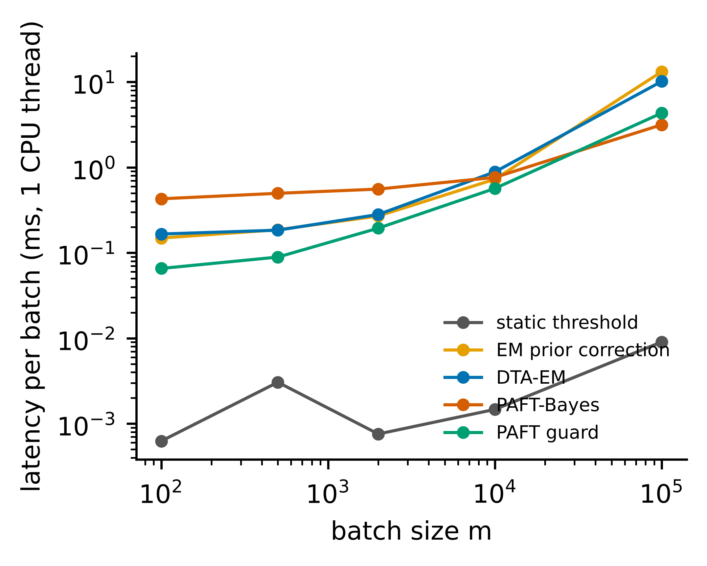

# S1 Implementation details

**Base learners (identical for all datasets).** LightGBM: up to 2,000 trees, learning rate 0.05, 31 leaves, row and column subsampling 0.8, minimum 20 samples per leaf, early stopping after 50 rounds on a 10% slice of the training split. XGBoost: histogram method, depth 6, learning rate 0.05, subsampling 0.8, up to 2,000 trees, early stopping after 50 rounds. Logistic regression: L2 penalty with C = 1, at most 300 L-BFGS iterations. Perceptron: 256 and 128 ReLU units, dropout 0.1, AdamW (learning rate 0.001, weight decay 1e-5), batch size 512, at most 40 epochs, patience 5.

**Pre-processing.** Categorical features are ordinal-encoded for tree models and frequency-encoded for the linear and neural models; the latter also receive median imputation and standardisation. All statistics are fitted on the training split.

**Decision layer.** Candidate thresholds: validation scores of each class, thinned to at most 1,024 class-wise quantiles. Histogram: B = min(32, max(8, ⌊n1/10⌋)) class-balanced quantile bins, Laplace smoothing 0.5. Prevalence grid: 161 points uniform in logit(π0) ± 9. Prior: σ = 2. Guard level: 0.01. EM baseline: at most 200 iterations, tolerance 1e-7, on isotonic-calibrated posteriors.

**Random seeds.** Splits and learners use seeds 0–4. Static-Bag thresholds are computed on candidate thresholds thinned to 512 quantiles per class. Deployment batches use a generator seeded by a CRC-32 hash of (dataset, model, seed, condition, metric, ρ, m), so every result is exactly reproducible; a complete re-run of the main experiment reproduced all 90,720 result rows with zero difference.

**Hardware and software.** 4 CPU cores, 15 GB RAM, no GPU; Python 3.13, scikit-learn 1.9.1, LightGBM 4.7.0, XGBoost 3.4.1, PyTorch 2.15.0 (CPU). The device (CPU, CUDA or Apple MPS) is detected automatically.

# S2 Results by base learner

| method | lgbm | logreg | mlp | xgb |
|---|---:|---:|---:|---:|
| Default 0.5 | 0.406 | 0.342 | 0.367 | 0.414 |
| Static-F | 0.496 | 0.447 | 0.466 | 0.503 |
| Static-Bag | 0.497 | 0.448 | 0.466 | 0.503 |
| EM-0.5 | 0.449 | 0.375 | 0.404 | 0.459 |
| EM-Fixed | 0.507 | 0.454 | 0.476 | 0.516 |
| PrevMatch | 0.509 | 0.452 | 0.473 | 0.515 |
| DTA-EM | 0.533 | 0.483 | 0.501 | 0.539 |
| PAFT-Plug | 0.526 | 0.475 | 0.494 | 0.532 |
| PAFT-Bayes | 0.532 | 0.481 | 0.500 | 0.538 |
| PAFT-Guard | 0.531 | 0.480 | 0.499 | 0.537 |
| Oracle-π | 0.537 | 0.487 | 0.505 | 0.543 |
| Oracle-threshold | 0.565 | 0.515 | 0.533 | 0.571 |

: **Table S1** Mean F1 under shift (ρ ≠ 1) by base learner

# S2 (continued)

| model | baseline | n_units | mean_diff | ci95_lo | ci95_hi | wins | ties | losses | p_wilcoxon | rank_biserial | p_holm |
|---|---:|---:|---:|---:|---:|---:|---:|---:|---:|---:|---:|
| lgbm | Static-F | 18 | +0.0355 | +0.0270 | +0.0453 | 18 | 0 | 0 | 0.00001 | 1.000 | 0.00002 |
| lgbm | DTA-EM | 18 | −0.0014 | −0.0067 | +0.0020 | 14 | 0 | 4 | 0.09874 | 0.450 | 0.09874 |
| lgbm | EM-Fixed | 18 | +0.0255 | +0.0178 | +0.0337 | 18 | 0 | 0 | 0.00001 | 1.000 | 0.00002 |
| xgb | Static-F | 18 | +0.0346 | +0.0232 | +0.0456 | 17 | 0 | 1 | 0.00011 | 0.930 | 0.00021 |
| xgb | DTA-EM | 18 | −0.0015 | −0.0071 | +0.0020 | 15 | 0 | 3 | 0.03036 | 0.579 | 0.03036 |
| xgb | EM-Fixed | 18 | +0.0220 | +0.0159 | +0.0280 | 18 | 0 | 0 | 0.00001 | 1.000 | 0.00002 |
| logreg | Static-F | 18 | +0.0342 | +0.0253 | +0.0425 | 17 | 0 | 1 | 0.00002 | 0.988 | 0.00003 |
| logreg | DTA-EM | 18 | −0.0014 | −0.0081 | +0.0027 | 13 | 0 | 5 | 0.05386 | 0.520 | 0.05386 |
| logreg | EM-Fixed | 18 | +0.0274 | +0.0209 | +0.0338 | 18 | 0 | 0 | 0.00001 | 1.000 | 0.00002 |
| mlp | Static-F | 18 | +0.0341 | +0.0231 | +0.0444 | 17 | 0 | 1 | 0.00033 | 0.883 | 0.00066 |
| mlp | DTA-EM | 18 | −0.0015 | −0.0080 | +0.0023 | 14 | 0 | 4 | 0.04828 | 0.532 | 0.04828 |
| mlp | EM-Fixed | 18 | +0.0239 | +0.0189 | +0.0288 | 18 | 0 | 0 | 0.00001 | 1.000 | 0.00002 |

: **Table S1b** Paired tests of PAFT-Bayes by base learner (unit: dataset)

# S3 Batch size

| method | 100 | 500 | 2000 | 10000 |
|---|---:|---:|---:|---:|
| Default 0.5 | 0.399 | 0.405 | 0.407 | 0.408 |
| Static-F | 0.499 | 0.496 | 0.497 | 0.497 |
| Static-Bag | 0.499 | 0.496 | 0.498 | 0.497 |
| EM-0.5 | 0.447 | 0.449 | 0.450 | 0.451 |
| EM-Fixed | 0.484 | 0.503 | 0.508 | 0.511 |
| PrevMatch | 0.476 | 0.497 | 0.512 | 0.517 |
| DTA-EM | 0.525 | 0.530 | 0.534 | 0.536 |
| PAFT-Plug | 0.495 | 0.517 | 0.528 | 0.533 |
| PAFT-Bayes | 0.517 | 0.527 | 0.534 | 0.535 |
| PAFT-Guard | 0.518 | 0.528 | 0.533 | 0.532 |
| Oracle-π | 0.536 | 0.536 | 0.538 | 0.538 |
| Oracle-threshold | 0.628 | 0.583 | 0.562 | 0.551 |

: **Table S2** Mean F1 under shift by batch size (LightGBM)

# S4 Seed variability

| method | mean | sd_over_seeds | min | max |
|---|---:|---:|---:|---:|
| Default 0.5 | 0.406 | 0.0063 | 0.396 | 0.412 |
| Static-F | 0.496 | 0.0017 | 0.494 | 0.499 |
| Static-Bag | 0.497 | 0.0020 | 0.494 | 0.499 |
| EM-0.5 | 0.449 | 0.0060 | 0.441 | 0.456 |
| EM-Fixed | 0.507 | 0.0072 | 0.499 | 0.517 |
| PrevMatch | 0.509 | 0.0036 | 0.503 | 0.512 |
| DTA-EM | 0.533 | 0.0024 | 0.530 | 0.536 |
| PAFT-Plug | 0.526 | 0.0044 | 0.519 | 0.530 |
| PAFT-Bayes | 0.532 | 0.0029 | 0.527 | 0.534 |
| PAFT-Guard | 0.531 | 0.0021 | 0.528 | 0.533 |
| Oracle-π | 0.537 | 0.0021 | 0.534 | 0.539 |
| Oracle-threshold | 0.565 | 0.0019 | 0.563 | 0.567 |

: **Table S3** Mean F1 under shift: mean, standard deviation, minimum and maximum over the five seeds (each seed value is a mean over 18 datasets)

# S5 Real suites: all rules including the exploratory sequential variant

| method | acs_income_states | bank_time | creditcard_time | electricity_time | elliptic_time | kdd99_time |
|---|---:|---:|---:|---:|---:|---:|
| Default 0.5 | 0.714 | 0.000 | 0.645 | 0.449 | 0.483 | 0.973 |
| Static-F | 0.702 | 0.233 | 0.645 | 0.450 | 0.483 | 0.973 |
| Static-Bag | 0.702 | 0.234 | 0.644 | 0.451 | 0.483 | 0.975 |
| EM-0.5 | 0.707 | 0.265 | 0.636 | 0.423 | 0.477 | 0.947 |
| EM-Fixed | 0.692 | 0.265 | 0.551 | 0.424 | 0.478 | 0.960 |
| PrevMatch | 0.708 | 0.263 | 0.635 | 0.384 | 0.481 | 0.973 |
| DTA-EM | 0.692 | 0.265 | 0.633 | 0.425 | 0.484 | 0.947 |
| PAFT-Plug | 0.693 | 0.265 | 0.638 | 0.426 | 0.477 | 0.947 |
| PAFT-Bayes | 0.693 | 0.265 | 0.641 | 0.426 | 0.477 | 0.947 |
| PAFT-Guard | 0.702 | 0.233 | 0.645 | 0.450 | 0.483 | 0.973 |
| PAFT-Seq (exploratory) | 0.693 | 0.265 | 0.643 | 0.426 | 0.477 | 0.947 |
| Oracle-π | 0.713 | 0.260 | 0.646 | 0.450 | 0.480 | 0.950 |
| Oracle-threshold | 0.720 | 0.272 | 0.729 | 0.721 | 0.600 | 0.988 |

: **Table S4** Mean F1 on real-shift suites. PAFT-Seq centres the prior on the previous batch's posterior mean (σ = 1); it was not part of the pre-specified comparison

# S5 (continued)

| method | acs_income_states | bank_time | creditcard_time | electricity_time | elliptic_time | kdd99_time |
|---|---:|---:|---:|---:|---:|---:|
| Default 0.5 | 0.001 | 0.000 | 0.075 | 0.008 | 0.011 | 0.007 |
| Static-F | 0.003 | 0.034 | 0.075 | 0.007 | 0.011 | 0.007 |
| Static-Bag | 0.003 | 0.031 | 0.072 | 0.008 | 0.011 | 0.005 |
| EM-0.5 | 0.001 | 0.000 | 0.069 | 0.009 | 0.004 | 0.034 |
| EM-Fixed | 0.004 | 0.000 | 0.228 | 0.006 | 0.004 | 0.012 |
| PrevMatch | 0.002 | 0.004 | 0.073 | 0.016 | 0.011 | 0.007 |
| DTA-EM | 0.003 | 0.000 | 0.072 | 0.008 | 0.019 | 0.034 |
| PAFT-Plug | 0.003 | 0.000 | 0.079 | 0.008 | 0.004 | 0.027 |
| PAFT-Bayes | 0.003 | 0.000 | 0.074 | 0.008 | 0.005 | 0.027 |
| PAFT-Guard | 0.003 | 0.034 | 0.075 | 0.007 | 0.011 | 0.007 |
| PAFT-Seq (exploratory) | 0.003 | 0.000 | 0.071 | 0.008 | 0.005 | 0.027 |
| Oracle-π | 0.001 | 0.004 | 0.069 | 0.008 | 0.006 | 0.029 |
| Oracle-threshold | 0.001 | 0.001 | 0.067 | 0.004 | 0.014 | 0.001 |

: **Table S4b** Standard deviation over seeds of the values in Table S4

# S5 (continued) 

| suite | model | DTA-EM | PAFT-Bayes | PAFT-Guard | Static-F |
|---|---:|---:|---:|---:|---:|
| acs_income_states | lgbm | 0.692 | 0.693 | 0.702 | 0.702 |
| acs_income_states | logreg | 0.655 | 0.656 | 0.663 | 0.664 |
| acs_income_states | mlp | 0.668 | 0.669 | 0.677 | 0.678 |
| acs_income_states | xgb | 0.692 | 0.693 | 0.701 | 0.702 |
| bank_time | lgbm | 0.265 | 0.265 | 0.233 | 0.233 |
| bank_time | logreg | 0.244 | 0.243 | 0.198 | 0.198 |
| bank_time | mlp | 0.260 | 0.015 | 0.015 | 0.015 |
| bank_time | xgb | 0.265 | 0.265 | 0.221 | 0.221 |
| creditcard_time | lgbm | 0.633 | 0.641 | 0.645 | 0.645 |
| creditcard_time | logreg | 0.535 | 0.551 | 0.555 | 0.555 |
| creditcard_time | mlp | 0.725 | 0.717 | 0.723 | 0.723 |
| creditcard_time | xgb | 0.726 | 0.742 | 0.732 | 0.732 |
| electricity_time | lgbm | 0.425 | 0.426 | 0.450 | 0.450 |
| electricity_time | logreg | 0.321 | 0.340 | 0.463 | 0.463 |
| electricity_time | mlp | 0.310 | 0.330 | 0.406 | 0.406 |
| electricity_time | xgb | 0.414 | 0.416 | 0.449 | 0.449 |
| elliptic_time | lgbm | 0.484 | 0.477 | 0.483 | 0.483 |
| elliptic_time | logreg | 0.291 | 0.293 | 0.305 | 0.305 |
| elliptic_time | mlp | 0.272 | 0.202 | 0.358 | 0.361 |
| elliptic_time | xgb | 0.481 | 0.480 | 0.486 | 0.486 |
| kdd99_time | lgbm | 0.947 | 0.947 | 0.973 | 0.973 |
| kdd99_time | logreg | 0.937 | 0.889 | 0.941 | 0.941 |
| kdd99_time | mlp | 0.926 | 0.906 | 0.936 | 0.936 |
| kdd99_time | xgb | 0.954 | 0.942 | 0.973 | 0.973 |

: **Table S4c** Real-shift suites by base learner

# S6 Guard firing rate by dataset

| dataset | guard_fire_rate_under_pure_label_shift |
|---|---:|
| Diabetes130US | 0.0003 |
| online_shoppers | 0.0003 |
| porto_seguro | 0.0006 |
| bank_marketing | 0.0010 |
| KDD09_churn | 0.0016 |
| default_credit | 0.0019 |
| kick | 0.0032 |
| KDD09_upselling | 0.0054 |
| Click_small | 0.0073 |
| census_income | 0.0130 |
| adult | 0.0184 |
| Amazon_employee | 0.0194 |
| nomao | 0.0378 |
| MiniBooNE | 0.0394 |
| jm1 | 0.0533 |
| KDD09_appetency | 0.0619 |
| APSFailure | 0.2044 |
| creditcard | 1.0000 |

: **Table S5** Fraction of batches under pure label shift on which the guard rejects (α = 0.01, LightGBM, all batch sizes)

# S7 Robustness: paired tests

| condition | baseline | n_units | mean_diff | ci95_lo | ci95_hi | wins | ties | losses | p_wilcoxon | rank_biserial | p_holm |
|---|---:|---:|---:|---:|---:|---:|---:|---:|---:|---:|---:|
| calib_platt | static | 18 | +0.0369 | +0.0287 | +0.0465 | 18 | 0 | 0 | 0.0000 | 1.000 | 0.0000 |
| calib_platt | dta_em | 18 | +0.0025 | −0.0015 | +0.0081 | 10 | 0 | 8 | 0.3466 | 0.263 | 0.3466 |
| calib_platt | paft_guard | 18 | +0.0016 | +0.0003 | +0.0032 | 14 | 1 | 3 | 0.0010 | 0.908 | 0.0020 |
| noise_0.1 | static | 18 | −0.0045 | −0.0342 | +0.0209 | 12 | 0 | 6 | 0.4683 | 0.205 | 0.9366 |
| noise_0.1 | dta_em | 18 | +0.0042 | −0.0030 | +0.0121 | 14 | 0 | 4 | 0.0432 | 0.544 | 0.1295 |
| noise_0.1 | paft_guard | 18 | −0.0173 | −0.0432 | +0.0037 | 12 | 0 | 6 | 0.9323 | 0.029 | 0.9366 |
| noise_0.25 | static | 18 | −0.0149 | −0.0647 | +0.0205 | 13 | 0 | 5 | 0.3927 | 0.240 | 0.7855 |
| noise_0.25 | dta_em | 18 | +0.0024 | −0.0036 | +0.0087 | 12 | 0 | 6 | 0.1674 | 0.380 | 0.5021 |
| noise_0.25 | paft_guard | 18 | −0.0255 | −0.0733 | +0.0066 | 13 | 0 | 5 | 0.4683 | 0.205 | 0.7855 |
| noise_0.5 | static | 18 | −0.0119 | −0.0544 | +0.0175 | 12 | 0 | 6 | 0.3466 | 0.263 | 0.6931 |
| noise_0.5 | dta_em | 18 | +0.0027 | −0.0041 | +0.0098 | 12 | 0 | 6 | 0.1964 | 0.357 | 0.5892 |
| noise_0.5 | paft_guard | 18 | −0.0191 | −0.0602 | +0.0086 | 11 | 0 | 7 | 0.7337 | 0.099 | 0.7337 |
| valfrac_0.1 | static | 18 | +0.0337 | +0.0228 | +0.0442 | 17 | 0 | 1 | 0.0003 | 0.895 | 0.0008 |
| valfrac_0.1 | dta_em | 18 | −0.0044 | −0.0111 | −0.0006 | 3 | 0 | 15 | 0.0104 | −0.673 | 0.0208 |
| valfrac_0.1 | paft_guard | 18 | −0.0010 | −0.0048 | +0.0014 | 11 | 4 | 3 | 0.1401 | 0.448 | 0.1401 |
| valfrac_0.25 | static | 18 | +0.0333 | +0.0231 | +0.0436 | 17 | 0 | 1 | 0.0001 | 0.953 | 0.0002 |
| valfrac_0.25 | dta_em | 18 | −0.0026 | −0.0077 | +0.0002 | 8 | 0 | 10 | 0.3466 | −0.263 | 0.3466 |
| valfrac_0.25 | paft_guard | 18 | −0.0004 | −0.0033 | +0.0015 | 10 | 5 | 3 | 0.0546 | 0.604 | 0.1092 |

: **Table S6** Paired tests of PAFT-Bayes under each robustness condition (unit: dataset)

# S8 Real suites: paired tests

| suite | baseline | n_units | mean_diff | ci95_lo | ci95_hi | wins | ties | losses | p_wilcoxon | rank_biserial | p_holm |
|---|---:|---:|---:|---:|---:|---:|---:|---:|---:|---:|---:|
| acs_income_states | static | 50 | −0.0093 | −0.0116 | −0.0068 | 3 | 3 | 44 | 0.0000 | −0.904 | 0.0000 |
| acs_income_states | dta_em | 50 | +0.0014 | +0.0008 | +0.0020 | 36 | 0 | 14 | 0.0000 | 0.678 | 0.0000 |
| acs_income_states | em_fixed | 50 | +0.0011 | +0.0002 | +0.0019 | 32 | 0 | 18 | 0.0035 | 0.467 | 0.0071 |
| acs_income_states | paft_guard | 50 | −0.0087 | −0.0109 | −0.0061 | 3 | 4 | 43 | 0.0000 | −0.900 | 0.0000 |
| acs_income_states | paft_plug | 50 | +0.0001 | +0.0000 | +0.0003 | 9 | 39 | 2 | 0.0329 | 0.727 | 0.0329 |
| bank_time | static | 10 | +0.0321 | +0.0135 | +0.0545 | 9 | 0 | 1 | 0.0059 | 0.927 | 0.0293 |
| bank_time | dta_em | 10 | +0.0000 | +0.0000 | +0.0000 | 0 | 10 | 0 | 1.0000 | 0.000 | 1.0000 |
| bank_time | em_fixed | 10 | +0.0000 | +0.0000 | +0.0000 | 0 | 10 | 0 | 1.0000 | 0.000 | 1.0000 |
| bank_time | paft_guard | 10 | +0.0321 | +0.0135 | +0.0545 | 9 | 0 | 1 | 0.0059 | 0.927 | 0.0293 |
| bank_time | paft_plug | 10 | +0.0000 | +0.0000 | +0.0000 | 0 | 10 | 0 | 1.0000 | 0.000 | 1.0000 |
| creditcard_time | static | 14 | −0.0044 | −0.0179 | +0.0129 | 3 | 5 | 6 | 0.2604 | −0.422 | 1.0000 |
| creditcard_time | dta_em | 14 | +0.0075 | −0.0078 | +0.0251 | 7 | 1 | 6 | 0.6002 | 0.165 | 1.0000 |
| creditcard_time | em_fixed | 14 | +0.0900 | +0.0571 | +0.1190 | 11 | 0 | 3 | 0.0017 | 0.886 | 0.0085 |
| creditcard_time | paft_guard | 14 | −0.0044 | −0.0179 | +0.0129 | 3 | 5 | 6 | 0.2604 | −0.422 | 1.0000 |
| creditcard_time | paft_plug | 14 | +0.0030 | −0.0054 | +0.0127 | 4 | 7 | 3 | 0.7353 | 0.143 | 1.0000 |
| electricity_time | static | 31 | −0.0244 | −0.0341 | −0.0156 | 5 | 0 | 26 | 0.0000 | −0.891 | 0.0000 |
| electricity_time | dta_em | 31 | +0.0004 | −0.0006 | +0.0015 | 13 | 11 | 7 | 0.1790 | 0.343 | 0.3579 |
| electricity_time | em_fixed | 31 | +0.0015 | +0.0007 | +0.0025 | 18 | 6 | 7 | 0.0035 | 0.668 | 0.0105 |
| electricity_time | paft_guard | 31 | −0.0244 | −0.0341 | −0.0156 | 5 | 0 | 26 | 0.0000 | −0.891 | 0.0000 |
| electricity_time | paft_plug | 31 | +0.0002 | −0.0004 | +0.0008 | 7 | 20 | 4 | 0.5337 | 0.212 | 0.5337 |
| elliptic_time | static | 15 | −0.0053 | −0.0268 | +0.0148 | 4 | 5 | 6 | 0.4446 | −0.273 | 1.0000 |
| elliptic_time | dta_em | 15 | −0.0067 | −0.0214 | +0.0025 | 4 | 7 | 4 | 0.7794 | −0.111 | 1.0000 |
| elliptic_time | em_fixed | 15 | −0.0008 | −0.0032 | +0.0024 | 2 | 7 | 6 | 0.2076 | −0.500 | 0.8986 |
| elliptic_time | paft_guard | 15 | −0.0053 | −0.0268 | +0.0148 | 4 | 5 | 6 | 0.4446 | −0.273 | 1.0000 |
| elliptic_time | paft_plug | 15 | +0.0005 | +0.0000 | +0.0015 | 2 | 13 | 0 | 0.1797 | 1.000 | 0.8986 |
| kdd99_time | static | 14 | −0.0263 | −0.0523 | −0.0060 | 3 | 0 | 11 | 0.0245 | −0.676 | 0.1227 |
| kdd99_time | dta_em | 14 | +0.0005 | −0.0153 | +0.0169 | 5 | 1 | 8 | 0.5525 | −0.187 | 1.0000 |
| kdd99_time | em_fixed | 14 | −0.0127 | −0.0284 | +0.0020 | 4 | 1 | 9 | 0.1730 | −0.429 | 0.5189 |
| kdd99_time | paft_guard | 14 | −0.0263 | −0.0523 | −0.0060 | 3 | 0 | 11 | 0.0245 | −0.676 | 0.1227 |
| kdd99_time | paft_plug | 14 | +0.0000 | +0.0000 | +0.0000 | 0 | 14 | 0 | 1.0000 | 0.000 | 1.0000 |

: **Table S7** Paired tests of PAFT-Bayes on real suites (unit: deployment batch, averaged over seeds)

# S9 Error analysis by shift level

| rho | F1_static | F1_paft | win | loss | worst_decile_gain | regret |
|---|---:|---:|---:|---:|---:|---:|
| 0.125 | 0.268 | 0.315 | 0.688 | 0.163 | −0.015 | 0.066 |
| 0.250 | 0.354 | 0.376 | 0.644 | 0.216 | −0.022 | 0.052 |
| 0.500 | 0.446 | 0.451 | 0.510 | 0.294 | −0.019 | 0.036 |
| 1.000 | 0.528 | 0.524 | 0.149 | 0.219 | −0.011 | 0.028 |
| 2.000 | 0.594 | 0.603 | 0.633 | 0.208 | −0.007 | 0.020 |
| 4.000 | 0.642 | 0.683 | 0.903 | 0.049 | 0.000 | 0.015 |
| 8.000 | 0.674 | 0.764 | 0.973 | 0.012 | 0.017 | 0.011 |

: **Table S8** Per-batch win and loss rates of PAFT-Bayes against Static-F by odds multiplier

# S9 (continued)

| dataset | gain_vs_static | gain_vs_dta | rel_err_pi | regret | prevalence_% | AUC_mean |
|---|---:|---:|---:|---:|---:|---:|
| creditcard | 0.002 | −0.042 | 0.213 | 0.088 | 0.173 | 0.926 |
| KDD09_appetency | 0.016 | 0.002 | 0.476 | 0.054 | 1.780 | 0.800 |
| KDD09_churn | 0.017 | 0.007 | 0.290 | 0.026 | 7.344 | 0.690 |
| nomao | 0.020 | 0.000 | 0.014 | 0.008 | 28.562 | 0.995 |
| KDD09_upselling | 0.023 | 0.001 | 0.082 | 0.030 | 7.364 | 0.860 |
| porto_seguro | 0.025 | 0.003 | 0.452 | 0.030 | 3.645 | 0.633 |
| APSFailure | 0.028 | −0.008 | 0.070 | 0.069 | 1.809 | 0.990 |
| online_shoppers | 0.028 | −0.001 | 0.077 | 0.032 | 15.475 | 0.928 |
| MiniBooNE | 0.030 | 0.000 | 0.015 | 0.010 | 28.062 | 0.984 |
| bank_marketing | 0.032 | 0.000 | 0.064 | 0.026 | 11.698 | 0.934 |
| Amazon_employee | 0.036 | 0.003 | 0.182 | 0.044 | 5.789 | 0.727 |
| Click_small | 0.038 | 0.004 | 0.129 | 0.023 | 16.842 | 0.698 |
| jm1 | 0.042 | 0.001 | 0.172 | 0.031 | 19.348 | 0.721 |
| Diabetes130US | 0.047 | 0.002 | 0.158 | 0.027 | 11.160 | 0.672 |
| census_income | 0.052 | 0.001 | 0.062 | 0.039 | 6.206 | 0.952 |
| default_credit | 0.054 | 0.003 | 0.073 | 0.019 | 22.120 | 0.779 |
| adult | 0.062 | −0.000 | 0.028 | 0.018 | 23.928 | 0.926 |
| kick | 0.089 | 0.000 | 0.071 | 0.027 | 12.299 | 0.777 |

: **Table S9** Per-dataset gains, relative prevalence error and regret (ρ ≠ 1)

# S10 Quantifier error

| quantifier | 100 | 500 | 2000 | 10000 |
|---|---:|---:|---:|---:|
| guard_fire_rate | 0.062 | 0.070 | 0.074 | 0.104 |
| pi_acc | 0.058 | 0.030 | 0.018 | 0.013 |
| pi_cc | 0.079 | 0.076 | 0.076 | 0.075 |
| pi_em | 0.047 | 0.023 | 0.014 | 0.010 |
| pi_hdy | 0.057 | 0.026 | 0.016 | 0.012 |
| pi_mean | 0.041 | 0.022 | 0.014 | 0.011 |
| pi_mle | 0.048 | 0.024 | 0.015 | 0.012 |
| pi_pacc | 0.048 | 0.025 | 0.015 | 0.011 |
| pi_pcc | 0.081 | 0.080 | 0.079 | 0.079 |

: **Table S10** Mean absolute error of prevalence estimators by batch size (the row guard_fire_rate is the guard's rejection rate)

# S11 Ablation: paired tests

| baseline | n_units | mean_diff | ci95_lo | ci95_hi | wins | ties | losses | p_wilcoxon | rank_biserial | p_holm |
|---|---:|---:|---:|---:|---:|---:|---:|---:|---:|---:|
| paft_plug | 18 | +0.0102 | +0.0071 | +0.0132 | 18 | 0 | 0 | 0.00001 | 1.000 | 0.00007 |
| paft_guard | 18 | +0.0006 | −0.0001 | +0.0013 | 13 | 1 | 4 | 0.01682 | 0.660 | 0.06372 |
| bayes_sd0.5 | 18 | −0.0005 | −0.0031 | +0.0018 | 9 | 0 | 9 | 0.79871 | 0.076 | 0.79871 |
| bayes_sd1.0 | 18 | −0.0020 | −0.0036 | −0.0007 | 6 | 0 | 12 | 0.01593 | −0.637 | 0.06372 |
| bayes_sd4.0 | 18 | +0.0036 | +0.0018 | +0.0057 | 18 | 0 | 0 | 0.00001 | 1.000 | 0.00007 |
| bayes_sdNone | 18 | +0.0071 | +0.0035 | +0.0117 | 18 | 0 | 0 | 0.00001 | 1.000 | 0.00007 |
| plug_acc | 18 | +0.0108 | +0.0063 | +0.0149 | 16 | 0 | 2 | 0.00025 | 0.895 | 0.00151 |
| plug_em | 18 | +0.0067 | +0.0040 | +0.0092 | 17 | 0 | 1 | 0.00025 | 0.895 | 0.00151 |
| dta_hist | 18 | +0.0017 | −0.0028 | +0.0049 | 13 | 0 | 5 | 0.04317 | 0.544 | 0.08633 |

: **Table S11** Paired tests of PAFT-Bayes against ablated variants (all batch sizes)

# S12 Other metrics: paired tests

| metric | baseline | n_units | mean_diff | ci95_lo | ci95_hi | wins | ties | losses | p_wilcoxon | rank_biserial | p_holm |
|---|---:|---:|---:|---:|---:|---:|---:|---:|---:|---:|---:|
| f0.5 | static | 18 | +0.0259 | +0.0079 | +0.0379 | 17 | 0 | 1 | 0.00193 | 0.789 | 0.00386 |
| f0.5 | dta_em | 18 | −0.0074 | −0.0224 | +0.0008 | 10 | 0 | 8 | 0.89858 | 0.041 | 0.89858 |
| f0.5 | em_fixed | 18 | +0.0356 | +0.0243 | +0.0471 | 17 | 0 | 1 | 0.00002 | 0.977 | 0.00007 |
| f2 | static | 18 | +0.0397 | +0.0282 | +0.0521 | 17 | 0 | 1 | 0.00002 | 0.977 | 0.00005 |
| f2 | dta_em | 18 | +0.0007 | −0.0032 | +0.0034 | 12 | 0 | 6 | 0.08977 | 0.462 | 0.08977 |
| f2 | em_fixed | 18 | +0.0193 | +0.0129 | +0.0264 | 18 | 0 | 0 | 0.00001 | 1.000 | 0.00002 |
| mcc | static | 18 | +0.0144 | +0.0079 | +0.0217 | 15 | 0 | 3 | 0.00025 | 0.895 | 0.00025 |
| mcc | em_fixed | 18 | +0.0400 | +0.0242 | +0.0585 | 18 | 0 | 0 | 0.00001 | 1.000 | 0.00002 |

: **Table S12** Paired tests for F0.5, F2 and MCC

# S13 Label-assisted variant: all budgets and paired tests

| suite | n_lab | Static-F | PAFT-Bayes (no labels) | Re-tune on labels | PAFT-L (labels → π) | PAFT-L + mixture | PAFT-L guarded | Oracle-π | Oracle-threshold |
|---|---:|---:|---:|---:|---:|---:|---:|---:|---:|
| acs_income_states | 50 | 0.702 | 0.693 | 0.692 | 0.712 | 0.693 | 0.711 | 0.713 | 0.720 |
| acs_income_states | 200 | 0.702 | 0.693 | 0.709 | 0.713 | 0.694 | 0.712 | 0.713 | 0.720 |
| acs_income_states | 1,000 | 0.702 | 0.693 | 0.715 | 0.713 | 0.697 | 0.712 | 0.713 | 0.720 |
| bank_time | 50 | 0.233 | 0.265 | 0.237 | 0.259 | 0.265 | 0.259 | 0.260 | 0.272 |
| bank_time | 200 | 0.233 | 0.265 | 0.248 | 0.259 | 0.264 | 0.259 | 0.259 | 0.272 |
| bank_time | 1,000 | 0.233 | 0.265 | 0.263 | 0.260 | 0.261 | 0.260 | 0.260 | 0.275 |
| controlled | 50 | 0.498 | 0.535 | 0.490 | 0.532 | 0.536 | 0.534 | 0.538 | 0.564 |
| controlled | 200 | 0.497 | 0.535 | 0.506 | 0.535 | 0.536 | 0.535 | 0.538 | 0.565 |
| creditcard_time | 50 | 0.645 | 0.640 | 0.625 | 0.649 | 0.640 | 0.649 | 0.646 | 0.729 |
| creditcard_time | 200 | 0.646 | 0.640 | 0.585 | 0.658 | 0.641 | 0.658 | 0.647 | 0.730 |
| creditcard_time | 1,000 | 0.644 | 0.641 | 0.514 | 0.639 | 0.639 | 0.639 | 0.647 | 0.732 |
| electricity_time | 50 | 0.450 | 0.426 | 0.692 | 0.449 | 0.430 | 0.449 | 0.450 | 0.721 |
| electricity_time | 200 | 0.450 | 0.426 | 0.706 | 0.449 | 0.436 | 0.449 | 0.450 | 0.722 |
| elliptic_time | 50 | 0.483 | 0.477 | 0.486 | 0.486 | 0.477 | 0.486 | 0.480 | 0.602 |
| elliptic_time | 200 | 0.484 | 0.477 | 0.543 | 0.481 | 0.479 | 0.481 | 0.485 | 0.604 |
| elliptic_time | 1,000 | 0.863 | 0.864 | 0.875 | 0.863 | 0.864 | 0.863 | 0.863 | 0.883 |
| kdd99_time | 50 | 0.973 | 0.947 | 0.964 | 0.951 | 0.947 | 0.951 | 0.950 | 0.988 |
| kdd99_time | 200 | 0.973 | 0.947 | 0.981 | 0.951 | 0.947 | 0.951 | 0.950 | 0.989 |
| kdd99_time | 1,000 | 0.973 | 0.947 | 0.987 | 0.950 | 0.946 | 0.950 | 0.950 | 0.989 |

: **Table S13** Label-assisted adaptation for all label budgets

# S13 (continued)

| suite | n_lab | baseline | n_units | mean_diff | ci95_lo | ci95_hi | wins | ties | losses | p_wilcoxon | rank_biserial | p_holm |
|---|---:|---:|---:|---:|---:|---:|---:|---:|---:|---:|---:|---:|
| acs_income_states | 50 | static | 50 | +0.0087 | +0.0052 | +0.0133 | 39 | 0 | 11 | 0.0000 | 0.743 | 0.0000 |
| acs_income_states | 50 | retune_labels | 50 | +0.0192 | +0.0171 | +0.0214 | 50 | 0 | 0 | 0.0000 | 1.000 | 0.0000 |
| acs_income_states | 50 | paft_bayes | 50 | +0.0180 | +0.0148 | +0.0215 | 47 | 1 | 2 | 0.0000 | 0.990 | 0.0000 |
| acs_income_states | 200 | static | 50 | +0.0097 | +0.0061 | +0.0145 | 40 | 0 | 10 | 0.0000 | 0.795 | 0.0000 |
| acs_income_states | 200 | retune_labels | 50 | +0.0032 | +0.0019 | +0.0045 | 39 | 0 | 11 | 0.0000 | 0.666 | 0.0000 |
| acs_income_states | 200 | paft_bayes | 50 | +0.0190 | +0.0157 | +0.0225 | 49 | 1 | 0 | 0.0000 | 1.000 | 0.0000 |
| acs_income_states | 1,000 | static | 50 | +0.0100 | +0.0064 | +0.0149 | 39 | 0 | 11 | 0.0000 | 0.804 | 0.0000 |
| acs_income_states | 1,000 | retune_labels | 50 | −0.0030 | −0.0041 | −0.0019 | 14 | 0 | 36 | 0.0000 | −0.667 | 0.0000 |
| acs_income_states | 1,000 | paft_bayes | 50 | +0.0192 | +0.0160 | +0.0228 | 50 | 0 | 0 | 0.0000 | 1.000 | 0.0000 |
| bank_time | 50 | static | 10 | +0.0258 | +0.0078 | +0.0497 | 9 | 0 | 1 | 0.0059 | 0.927 | 0.0176 |
| bank_time | 50 | retune_labels | 10 | +0.0223 | +0.0113 | +0.0328 | 9 | 0 | 1 | 0.0137 | 0.855 | 0.0273 |
| bank_time | 50 | paft_bayes | 10 | −0.0063 | −0.0167 | +0.0004 | 2 | 0 | 8 | 0.1934 | −0.491 | 0.1934 |
| bank_time | 200 | static | 10 | +0.0258 | +0.0075 | +0.0499 | 8 | 0 | 2 | 0.0098 | 0.891 | 0.0293 |
| bank_time | 200 | retune_labels | 10 | +0.0101 | +0.0020 | +0.0166 | 8 | 0 | 2 | 0.0645 | 0.673 | 0.1289 |
| bank_time | 200 | paft_bayes | 10 | −0.0062 | −0.0169 | +0.0009 | 3 | 0 | 7 | 0.2754 | −0.418 | 0.2754 |
| bank_time | 1,000 | static | 10 | +0.0266 | +0.0084 | +0.0512 | 9 | 0 | 1 | 0.0059 | 0.927 | 0.0176 |
| bank_time | 1,000 | retune_labels | 10 | −0.0029 | −0.0134 | +0.0039 | 6 | 0 | 4 | 0.6953 | 0.164 | 0.6953 |
| bank_time | 1,000 | paft_bayes | 10 | −0.0055 | −0.0156 | +0.0013 | 3 | 0 | 7 | 0.2754 | −0.418 | 0.5508 |
| controlled | 50 | static | 18 | +0.0361 | +0.0266 | +0.0461 | 17 | 0 | 1 | 0.0000 | 0.988 | 0.0000 |
| controlled | 50 | retune_labels | 18 | +0.0445 | +0.0353 | +0.0544 | 18 | 0 | 0 | 0.0000 | 1.000 | 0.0000 |
| controlled | 50 | paft_bayes | 18 | −0.0007 | −0.0037 | +0.0010 | 12 | 0 | 6 | 0.0814 | 0.474 | 0.0814 |
| controlled | 200 | static | 18 | +0.0378 | +0.0294 | +0.0472 | 18 | 0 | 0 | 0.0000 | 1.000 | 0.0000 |
| controlled | 200 | retune_labels | 18 | +0.0287 | +0.0197 | +0.0391 | 18 | 0 | 0 | 0.0000 | 1.000 | 0.0000 |
| controlled | 200 | paft_bayes | 18 | +0.0007 | −0.0003 | +0.0014 | 17 | 0 | 1 | 0.0019 | 0.789 | 0.0019 |
| creditcard_time | 50 | static | 14 | +0.0045 | −0.0136 | +0.0224 | 9 | 0 | 5 | 0.4631 | 0.238 | 0.4631 |
| creditcard_time | 50 | retune_labels | 14 | +0.0241 | +0.0038 | +0.0440 | 11 | 0 | 3 | 0.0245 | 0.676 | 0.0736 |
| creditcard_time | 50 | paft_bayes | 14 | +0.0091 | +0.0001 | +0.0183 | 9 | 0 | 5 | 0.0785 | 0.543 | 0.1570 |
| creditcard_time | 200 | static | 14 | +0.0123 | −0.0048 | +0.0321 | 7 | 0 | 7 | 0.5016 | 0.219 | 0.5016 |
| creditcard_time | 200 | retune_labels | 14 | +0.0731 | +0.0483 | +0.0960 | 12 | 0 | 2 | 0.0006 | 0.943 | 0.0018 |
| creditcard_time | 200 | paft_bayes | 14 | +0.0181 | +0.0079 | +0.0284 | 11 | 0 | 3 | 0.0067 | 0.790 | 0.0134 |
| creditcard_time | 1,000 | static | 14 | −0.0052 | −0.0213 | +0.0113 | 5 | 0 | 9 | 0.4263 | −0.257 | 0.8525 |
| creditcard_time | 1,000 | retune_labels | 14 | +0.1250 | +0.0934 | +0.1530 | 13 | 0 | 1 | 0.0002 | 0.981 | 0.0007 |
| creditcard_time | 1,000 | paft_bayes | 14 | −0.0021 | −0.0131 | +0.0081 | 8 | 0 | 6 | 0.9515 | −0.029 | 0.9515 |
| electricity_time | 50 | static | 31 | −0.0013 | −0.0026 | −0.0001 | 11 | 1 | 19 | 0.0859 | −0.359 | 0.0859 |
| electricity_time | 50 | retune_labels | 31 | −0.2429 | −0.3180 | −0.1674 | 7 | 0 | 24 | 0.0000 | −0.887 | 0.0000 |
| electricity_time | 50 | paft_bayes | 31 | +0.0231 | +0.0150 | +0.0321 | 25 | 0 | 6 | 0.0000 | 0.903 | 0.0000 |
| electricity_time | 200 | static | 31 | −0.0008 | −0.0020 | +0.0002 | 10 | 5 | 16 | 0.1587 | −0.316 | 0.1587 |
| electricity_time | 200 | retune_labels | 31 | −0.2565 | −0.3323 | −0.1802 | 5 | 0 | 26 | 0.0000 | −0.919 | 0.0000 |
| electricity_time | 200 | paft_bayes | 31 | +0.0234 | +0.0152 | +0.0325 | 26 | 0 | 5 | 0.0000 | 0.915 | 0.0000 |
| elliptic_time | 50 | static | 15 | +0.0031 | −0.0049 | +0.0161 | 4 | 4 | 7 | 0.2132 | −0.424 | 0.6397 |
| elliptic_time | 50 | retune_labels | 15 | −0.0005 | −0.0950 | +0.0786 | 9 | 0 | 6 | 0.3894 | 0.267 | 0.7788 |
| elliptic_time | 50 | paft_bayes | 15 | +0.0090 | −0.0015 | +0.0267 | 5 | 4 | 6 | 1.0000 | 0.000 | 1.0000 |
| elliptic_time | 200 | static | 15 | −0.0023 | −0.0218 | +0.0163 | 5 | 4 | 6 | 0.5937 | −0.182 | 1.0000 |
| elliptic_time | 200 | retune_labels | 15 | −0.0614 | −0.1523 | +0.0119 | 8 | 0 | 7 | 0.5614 | −0.183 | 1.0000 |
| elliptic_time | 200 | paft_bayes | 15 | +0.0042 | −0.0001 | +0.0094 | 6 | 4 | 5 | 0.3281 | 0.333 | 0.9842 |
| elliptic_time | 1,000 | static | 1 | +0.0004 | +0.0004 | +0.0004 | 1 | 0 | 0 | 1.0000 | 1.000 | 1.0000 |
| elliptic_time | 1,000 | retune_labels | 1 | −0.0115 | −0.0115 | −0.0115 | 0 | 0 | 1 | 1.0000 | −1.000 | 1.0000 |
| elliptic_time | 1,000 | paft_bayes | 1 | −0.0003 | −0.0003 | −0.0003 | 0 | 0 | 1 | 1.0000 | −1.000 | 1.0000 |
| kdd99_time | 50 | static | 14 | −0.0220 | −0.0426 | −0.0070 | 1 | 0 | 13 | 0.0004 | −0.962 | 0.0011 |
| kdd99_time | 50 | retune_labels | 14 | −0.0128 | −0.0256 | −0.0011 | 4 | 0 | 10 | 0.0676 | −0.562 | 0.1353 |
| kdd99_time | 50 | paft_bayes | 14 | +0.0043 | −0.0087 | +0.0162 | 11 | 0 | 3 | 0.0785 | 0.543 | 0.1353 |
| kdd99_time | 200 | static | 14 | −0.0225 | −0.0434 | −0.0067 | 2 | 0 | 12 | 0.0009 | −0.924 | 0.0026 |
| kdd99_time | 200 | retune_labels | 14 | −0.0303 | −0.0568 | −0.0106 | 4 | 0 | 10 | 0.0107 | −0.752 | 0.0215 |
| kdd99_time | 200 | paft_bayes | 14 | +0.0039 | −0.0094 | +0.0156 | 9 | 2 | 3 | 0.1361 | 0.487 | 0.1361 |
| kdd99_time | 1,000 | static | 14 | −0.0238 | −0.0481 | −0.0060 | 2 | 0 | 12 | 0.0009 | −0.924 | 0.0026 |
| kdd99_time | 1,000 | retune_labels | 14 | −0.0370 | −0.0742 | −0.0115 | 3 | 0 | 11 | 0.0023 | −0.867 | 0.0046 |
| kdd99_time | 1,000 | paft_bayes | 14 | +0.0025 | −0.0103 | +0.0145 | 8 | 3 | 3 | 0.2860 | 0.364 | 0.2860 |

: **Table S13b** Paired tests of guarded PAFT-L

# S14 Per-dataset results

| dataset | PAFT-Bayes | Static-F | DTA-EM | EM-Fixed | Oracle-π | Oracle-threshold |
|---|---:|---:|---:|---:|---:|---:|
| APSFailure | 0.763 | 0.735 | 0.771 | 0.754 | 0.772 | 0.832 |
| Amazon_employee | 0.358 | 0.322 | 0.355 | 0.314 | 0.364 | 0.401 |
| Click_small | 0.409 | 0.372 | 0.405 | 0.368 | 0.415 | 0.433 |
| Diabetes130US | 0.331 | 0.284 | 0.329 | 0.307 | 0.335 | 0.357 |
| KDD09_appetency | 0.189 | 0.173 | 0.187 | 0.161 | 0.196 | 0.243 |
| KDD09_churn | 0.271 | 0.253 | 0.264 | 0.232 | 0.272 | 0.296 |
| KDD09_upselling | 0.537 | 0.514 | 0.537 | 0.523 | 0.540 | 0.567 |
| MiniBooNE | 0.869 | 0.840 | 0.869 | 0.866 | 0.870 | 0.879 |
| adult | 0.709 | 0.647 | 0.709 | 0.704 | 0.711 | 0.727 |
| bank_marketing | 0.592 | 0.560 | 0.591 | 0.560 | 0.594 | 0.618 |
| census_income | 0.600 | 0.548 | 0.599 | 0.582 | 0.605 | 0.639 |
| creditcard | 0.749 | 0.747 | 0.790 | 0.677 | 0.770 | 0.837 |
| default_credit | 0.539 | 0.486 | 0.537 | 0.501 | 0.542 | 0.559 |
| jm1 | 0.448 | 0.406 | 0.447 | 0.422 | 0.455 | 0.478 |
| kick | 0.480 | 0.391 | 0.480 | 0.470 | 0.483 | 0.507 |
| nomao | 0.932 | 0.912 | 0.932 | 0.932 | 0.932 | 0.940 |
| online_shoppers | 0.638 | 0.610 | 0.639 | 0.610 | 0.644 | 0.671 |
| porto_seguro | 0.163 | 0.138 | 0.160 | 0.134 | 0.167 | 0.193 |

: **Table S14** Mean F1 under shift per dataset (LightGBM)

# S15 Full efficiency measurements

| component | m | ms | peak_mb |
|---|---:|---:|---:|
| fit decision layer (once, incl. 50 bootstrap static thresholds) | 9,766 | 3696.230 | 14.19 |
| static threshold (comparison only) | 100 | 0.001 | – |
| EM prior correction (SLD) | 100 | 0.149 | – |
| DTA-EM (EM + sort + expected-F scan) | 100 | 0.166 | – |
| PAFT-Plug | 100 | 0.036 | – |
| PAFT-Bayes | 100 | 0.429 | – |
| PAFT guard (KS test) | 100 | 0.066 | – |
| all rules (decide) | 100 | 1.149 | – |
| static threshold (comparison only) | 500 | 0.003 | – |
| EM prior correction (SLD) | 500 | 0.186 | – |
| DTA-EM (EM + sort + expected-F scan) | 500 | 0.184 | – |
| PAFT-Plug | 500 | 0.042 | – |
| PAFT-Bayes | 500 | 0.498 | – |
| PAFT guard (KS test) | 500 | 0.089 | – |
| all rules (decide) | 500 | 1.283 | – |
| static threshold (comparison only) | 2,000 | 0.001 | – |
| EM prior correction (SLD) | 2,000 | 0.270 | – |
| DTA-EM (EM + sort + expected-F scan) | 2,000 | 0.281 | – |
| PAFT-Plug | 2,000 | 0.081 | – |
| PAFT-Bayes | 2,000 | 0.558 | – |
| PAFT guard (KS test) | 2,000 | 0.194 | – |
| all rules (decide) | 2,000 | 1.513 | – |
| static threshold (comparison only) | 10,000 | 0.001 | – |
| EM prior correction (SLD) | 10,000 | 0.727 | – |
| DTA-EM (EM + sort + expected-F scan) | 10,000 | 0.886 | – |
| PAFT-Plug | 10,000 | 0.322 | – |
| PAFT-Bayes | 10,000 | 0.765 | – |
| PAFT guard (KS test) | 10,000 | 0.567 | – |
| all rules (decide) | 10,000 | 3.040 | – |
| static threshold (comparison only) | 100,000 | 0.009 | – |
| EM prior correction (SLD) | 100,000 | 13.237 | – |
| DTA-EM (EM + sort + expected-F scan) | 100,000 | 10.183 | – |
| PAFT-Plug | 100,000 | 2.852 | – |
| PAFT-Bayes | 100,000 | 3.162 | – |
| PAFT guard (KS test) | 100,000 | 4.333 | – |
| all rules (decide) | 100,000 | 29.978 | – |
| retrain LightGBM on adult (reference) | 24,424 | 1511.210 | – |
| stored state: thresholds T x grid G surface (float64) | 329,728 | – | 2.52 |

: **Table S15** All latency and memory measurements

# S16 Guard calibration on synthetic scores (Experiment 10)

| score_shift | n1_val | rho=1, m=500 | rho=1, m=2000 | rho=1, m=10000 | rho=4, m=500 | rho=4, m=2000 | rho=4, m=10000 |
|---|---:|---:|---:|---:|---:|---:|---:|
| 0.000 | 50.000 | 0.010 | 0.002 | 0.068 | 0.000 | 0.004 | 0.000 |
| 0.000 | 100.000 | 0.000 | 0.002 | 0.000 | 0.000 | 0.000 | 0.002 |
| 0.000 | 500.000 | 0.004 | 0.002 | 0.002 | 0.000 | 0.000 | 0.002 |
| 0.000 | 5000.000 | 0.002 | 0.002 | 0.004 | 0.000 | 0.000 | 0.006 |
| 0.250 | 50.000 | 0.352 | 0.610 | 0.990 | 0.028 | 0.138 | 0.180 |
| 0.250 | 100.000 | 0.486 | 0.826 | 0.992 | 0.048 | 0.358 | 0.226 |
| 0.250 | 500.000 | 0.604 | 0.996 | 1.000 | 0.120 | 0.718 | 1.000 |
| 0.250 | 5000.000 | 0.618 | 0.998 | 1.000 | 0.142 | 0.932 | 1.000 |
| 0.500 | 50.000 | 0.698 | 0.830 | 0.920 | 0.080 | 0.138 | 0.166 |
| 0.500 | 100.000 | 0.854 | 1.000 | 1.000 | 0.138 | 0.412 | 0.670 |
| 0.500 | 500.000 | 0.988 | 1.000 | 1.000 | 0.396 | 0.996 | 1.000 |
| 0.500 | 5000.000 | 0.994 | 1.000 | 1.000 | 0.614 | 1.000 | 1.000 |

: **Table S16** Rejection rate of the guard (level 0.01) on binormal scores (class separation 2 s.d., development prevalence 0.05) when every batch is a fresh sample. score_shift = 0 is pure label shift (rate = size); score_shift > 0 displaces all deployment scores by that many s.d. (rate = power). 500 batches per cell over 10 validation draws

# S17 Dataset screening

| Dataset | OpenML id | Decision |
|---|---:|---:|
| adult | 1,590 | included |
| bank-marketing | 1,461 | included |
| creditcard | 1,597 | included |
| default-of-credit-card-clients | 42,477 | included |
| APSFailure | 41,138 | included |
| KDDCup09_appetency | 1,111 | included |
| KDDCup09_churn | 1,112 | included |
| KDDCup09_upselling | 1,114 | included |
| Click_prediction_small | 1,220 | included |
| nomao | 1,486 | included |
| MiniBooNE | 41,150 | included |
| jm1 | 1,053 | included |
| Amazon_employee_access | 4,135 | included |
| kick | 41,162 | included |
| Diabetes130US | 4,541 | included (binarised: readmission < 30 days) |
| online_shoppers | 45,060 | included |
| porto-seguro | 42,742 | included |
| Census-Income-KDD | 42,750 | included |
| MagicTelescope | 1,120 | excluded: minority prevalence 35 % |
| eeg-eye-state | 1,471 | excluded: minority prevalence 45 % |
| electricity | 151 | excluded: minority prevalence 42 % (used in the temporal suite) |
| PhishingWebsites | 4,534 | excluded: minority prevalence 44 % |
| airlines | 1,169 | excluded: minority prevalence 45 % |
| higgs | 23,512 | excluded: minority prevalence 47 % |
| numerai28.6 | 23,517 | excluded: minority prevalence 49 % |
| mammography | 310 | excluded: 260 minority instances |
| road-safety | 42,803 | excluded: target not binary |
| data id 45557 | 45,557 | excluded: fewer than 10,000 instances |
| SantanderCustomerSatisfaction | 42,395 | eligible by description but download failed repeatedly; not included |

: **Table S17** OpenML datasets screened against the inclusion criteria (binary target, at least 10,000 instances, at least 400 minority instances, minority prevalence at most 30 %)

# S18 Sensitivity to cells with few expected positives

| cells | share_of_cells | baseline | n_units | mean_diff | ci95_lo | ci95_hi | wins | ties | losses | p_wilcoxon | rank_biserial | p_holm |
|---|---:|---:|---:|---:|---:|---:|---:|---:|---:|---:|---:|---:|
| all cells | 1.00 | static | 18 | +0.0355 | +0.0270 | +0.0453 | 18 | 0 | 0 | 0.00001 | 1.000 | 0.00002 |
| all cells | 1.00 | dta_em | 18 | −0.0014 | −0.0067 | +0.0020 | 14 | 0 | 4 | 0.09874 | 0.450 | 0.09874 |
| all cells | 1.00 | em_fixed | 18 | +0.0255 | +0.0178 | +0.0337 | 18 | 0 | 0 | 0.00001 | 1.000 | 0.00002 |
| expected positives >= 5 | 0.93 | static | 18 | +0.0376 | +0.0302 | +0.0463 | 18 | 0 | 0 | 0.00001 | 1.000 | 0.00002 |
| expected positives >= 5 | 0.93 | dta_em | 18 | +0.0012 | +0.0003 | +0.0022 | 15 | 0 | 3 | 0.00896 | 0.684 | 0.00896 |
| expected positives >= 5 | 0.93 | em_fixed | 18 | +0.0230 | +0.0165 | +0.0294 | 18 | 0 | 0 | 0.00001 | 1.000 | 0.00002 |
| expected positives >= 20 | 0.81 | static | 18 | +0.0401 | +0.0333 | +0.0482 | 18 | 0 | 0 | 0.00001 | 1.000 | 0.00002 |
| expected positives >= 20 | 0.81 | dta_em | 18 | +0.0007 | +0.0001 | +0.0015 | 11 | 0 | 7 | 0.28373 | 0.298 | 0.28373 |
| expected positives >= 20 | 0.81 | em_fixed | 18 | +0.0199 | +0.0139 | +0.0258 | 18 | 0 | 0 | 0.00001 | 1.000 | 0.00002 |

: **Table S18** Paired tests of PAFT-Bayes restricted to benchmark cells whose expected number of positives (target prevalence times batch size) exceeds a minimum

{width=3.5in}
